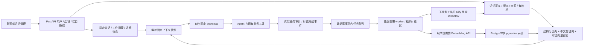

# 记忆系统实施与验收

更新：2026-10-21。本文记录当前代码和本机验收；前期调研与目标架构见 `research/agent-memory-architecture-2026-10-20.md`。

## 当前结构



- 短期：稳定本地 session_id，默认最近 3 轮完整原文、简短任务线索、最多 3 条活跃摘要索引。久未用索引转冷，history_read 按需搜索索引和读取原文，完整历史摘要不主动注入。Dify 自带历史窗口保持关闭，详见[索引式上下文管理](../design/索引式上下文管理.md)。
- 长期：偏好与约定、已确认决策、历史事件、流程经验。明确保存立即生效；自动推断与反思只形成待确认候选，不能覆盖用户设置。业务事件来自实际提交的审计与执行回执。
- 存储：PostgreSQL 保存真值、版本、来源、依赖关系、抑制重学记录、任务和每轮引用；向量是可重建的派生索引。当前向量路径是授权候选内精确距离查询加 RRF 融合，未建 ANN/HNSW 索引或启用 reranker。
- 权限：个人、个人店铺、个人栏目以及显式授权的店铺共享空间分开。检索前筛选空间与来源，再做排序。演练/正式数据环境参与空间范围与来源指纹校验。原始聊天不会通过共享发布扩散。
- 纠正与遗忘：CAS 版本检查、生效时间和失效时间；忘记会清除本地记忆正文、历史版本正文、证据片段与索引，递归处理派生内容，并排除依赖这些内容的旧回答和摘要。正在使用旧快照的流与工具请求会被拒绝。原始聊天、Dify 历史、日志和备份不在此次物理删除范围。
- 后台：独立 worker，事务内 outbox，租约与 SKIP LOCKED，失败退避重试，最多 4 次后标记失败；用户可在管理页重新整理。保存成功只依据数据库或工具回执，不依据模型口头承诺。

## Embedding API 配置

按用户要求：所有下载都须事先得到明确允许。本轮不下载模型、依赖、镜像或数据；启动脚本不包含本地模型启动路径。实施验收当时，之前落在 `.runtime/` 的模型环境或文件未继续下载或删除。2026-10-21 按用户清理项目文件的要求，确认代码与进程均未使用后，已移除旧本地模型和专用环境。

已按用户最新提供的配置切换为阿里百炼 DashScope `text-embedding-v3`，并启用真实向量检索。私有 `.env` 已替换旧服务的地址、密钥、模型、维度和 revision，API 与 worker 已重启。以下为当前配置形态，示例不包含真实密钥：

```dotenv
# 完整 /embeddings 地址；也支持以 /v1 结尾的 base URL，自动追加 /embeddings。
MEMORY_EMBEDDING_ENABLED=true
MEMORY_EMBEDDING_URL=https://dashscope.aliyuncs.com/compatible-mode/v1/embeddings
MEMORY_EMBEDDING_API_KEY=YOUR_PRIVATE_KEY
MEMORY_EMBEDDING_MODEL=text-embedding-v3
MEMORY_EMBEDDING_DIMENSIONS=1024
MEMORY_EMBEDDING_REVISION=dashscope-text-embedding-v3-v1
MEMORY_EMBEDDING_QUERY_TIMEOUT=1.5
MEMORY_EMBEDDING_INDEX_TIMEOUT=30
```

当前适配器使用 `POST`、可选 `Authorization: Bearer ...`，JSON 请求为：

```json
{"model":"YOUR_MODEL","input":"需要向量化的记忆或查询","encoding_format":"float"}
```

用户提供的 `EMBEDDING_BASE_URL`、`EMBEDDING_API_KEY`、`EMBEDDING_MODEL`、`EMBEDDING_DIM` 已分别映射到项目现有的 `MEMORY_EMBEDDING_*` 配置；base URL 自动补全 `/embeddings`。

该模型支持文本字符串和默认 1024 维输出，因此沿用已有 OpenAI 兼容适配器即可，未安装 SDK 或下载模型。协议参考[阿里云官方文档](https://help.aliyun.com/zh/model-studio/embedding-interfaces-compatible-with-openai/)。本次真实请求也已验证输出为 1024 维。

响应约定：`{"data":[{"embedding":[0.1,0.2,...]}]}`，须为配置维度的非零有限数值数组。不会跟随重定向，不会在日志或设置接口返回密钥；密钥使用 SecretStr。若服务商协议不同，后续修改 `backend/commerce/memory/embeddings.py` 适配器，无需改变记忆存储与权限。

URL、模型、revision、维度共同确定索引身份，密钥轮换不改变身份。配置完成或变更模型后，worker 每 30 秒检查当前仍有效/计划生效且未遗忘的版本，幂等安排补建；旧模型向量不会混入新模型检索。变更同名模型权重时应增加 revision，并重启所有 API/worker 进程。表中向量维度不固定为 1024。

未配置时任务等待，不自动反复请求模型；正文和关键词可用。查询 API 超时、响应无效或索引不可用时降级为关键词，返回状态与耗时；后台失败可重试。向量扩展必须由部署环境预先提供，应用启动不执行安装或下载。`compose.yaml` 的新环境构建会获取依赖，必须另行获得下载许可，本轮未执行。

## 页面与接口

聊天区有“记忆管理”和“临时对话”。管理页支持新增、纠正、停用、确认候选、版本与来源、有效期、忘记和后台失败重试；共享发布按钮仅对具备授权且来源可共享的条目显示。临时对话不读取历史或长期记忆，也不进入后台整理；关闭长期记忆读取不会删除保存内容。

| 接口 | 用途 |
| --- | --- |
| GET / PATCH `/api/memory/settings` | 读取/自动整理/反思开关及后台状态 |
| GET / POST `/api/memory/items` | 授权列表与明确保存 |
| GET / PATCH `/api/memory/items/{id}` | 来源、版本和 CAS 纠正 |
| POST `/api/memory/forget` | 忘记选定条目及依赖 |
| POST `/api/memory/items/{id}/publish` | 显式发布到已授权店铺共享空间 |
| POST `/api/memory/search` | 当前授权范围内检索 |
| POST `/api/memory/jobs/retry` | 仅重试本人的失败任务 |
| POST `/internal/agent-context/bootstrap` | 固定鉴权装载本轮上下文 |
| GET `/api/chat/runs/{id}/memory` | 本轮引用与耗时 |

共享空间默认不发放权限，由部署维护者使用 `scripts/memory_grants.py` 指定已有 owner、user、shop，并可设置 `--publish` / `--manage` / `--revoke`。Agent 无权发放共享权限。聊天来源不得自动发布；需人工独立编写可共享约定。

## 本机验证

以下为最初首版验收；当时未配置真实 Embedding 服务，也未调用真实店铺 API。本轮接入结果另列于下节。

| 验证 | 结果与范围 |
| --- | --- |
| 后端完整回归 | 137 passed；独立 PostgreSQL schema，结束后清理，包含原有业务测试与记忆全局关闭验证 |
| 前端 | vue-tsc 与 Vite build 通过 |
| 浏览器 | 5 项通过，0 页面脚本错误；保存、纠正与版本、设置提交、忘记；1440/1024/390 无横向溢出，已人工查看截图 |
| 真实 Dify Agent | 5 次请求均首轮成功，覆盖跨会话、纠正、遗忘、自然语言保存；后台真实摘要入库通过；临时验收账号清理完成 |
| Embedding 接口与存储 | HTTP 响应模拟加真实 PostgreSQL 向量查询：鉴权、维度/非法值、模型身份、跨店铺过滤、3→4 维切换与补建、遗忘发生于请求期间的结果拒绝；这不代表真实 Embedding API 已验收 |
| 共享与失败 | 私人来源不能发布、未授权不能纠正、共享遗忘清除读取者的依赖历史、失败重试仅处理本人任务 |

实际运行报告：`tests/artifacts/reports/memory-live-report.json`、`tests/artifacts/reports/memory-browser-report.json`。真实 Dify 本轮总耗时分别为 8431.1、4589.0、5095.1、3811.7、4145.1 ms，首 token 与各轮结果保留在报告；应用未启用记忆内容缓存，模型服务缓存状态不可控。先前联调曾出现上游超时与工具参数校验错误，当前本轮未复现，不将本机通过外推为服务稳定性承诺。

复验命令（只使用现有环境；缺少依赖时先取得下载许可）：

```bash
.venv/bin/python -m pytest backend/tests -q --tb=short
PATH="$PWD/.runtime/node/bin:$PATH" npm --prefix frontend run build
.venv/bin/python -m tests.scripts.browser_memory_smoke
# 以下调用现有真实 Dify 模型，使用临时测试账号。
.venv/bin/python -m tests.scripts.memory_live_smoke
# 真实 Embedding 验收；须启用且账户余额可用，会消耗 API 用量。
.venv/bin/python -m tests.scripts.memory_embedding_smoke
```

## 先前硅基流动接入结果

- 已保存私有配置并重启服务；`.env` 权限为 0600，密钥不进入代码、公开配置或验收报告。
- 首次真实文本请求：HTTP 200，模型 `Qwen/Qwen3-VL-Embedding-8B`，输出 4096 维，总耗时 273.8 ms，输入 27 tokens。这是一次连通性样本，不是稳定延迟指标。
- 后续真实后台索引请求出现 HTTP 402，另一次诊断返回 `code=30001`、`Sorry, your account balance is insufficient`。
- 当时完整的后台索引、改写查询召回、店铺隔离、纠正和遗忘验收因余额不足中止，不能记作真实语义检索通过；临时账号与测试记忆已清理。历史报告保留为 `tests/artifacts/archive/2026-10-23/reports/memory-embedding-siliconflow-report.json`。
- 当时暂停了 Embedding 调用；当前配置已按用户要求替换为阿里百炼，不再调用旧服务。未充值、未下载任何内容。
- 上一轮后端完整回归：138 passed，35.70 秒；真实 API 验收的阻塞状态与这些离线/数据库回归结果分别记录。

## 本轮阿里百炼接入结果

2026-10-21，真实 `text-embedding-v3` API 与真实 PostgreSQL、后台 worker、HTTP 检索接口联调，使用合成记忆和临时账号，未调用真实店铺平台接口。

- 连通性请求：HTTP 200，1024 维，总耗时 251.0 ms，输入 12 tokens。
- 5 项真实链路验收通过：后台保存向量、超出关键词匹配的语义召回、跨店铺向量隔离、纠正后使用新版本、忘记后清除向量并停止召回。
- 两条改写查询“滞留包裹催揽收”“无理由退货受理步骤”的关键词对照均为空；混合检索均将对应记忆排在第一位。查询向量 API 耗时分别为 269.74 / 222.24 ms，后端检索总耗时为 278.33 / 228.42 ms；这只是两个测试样本，不代表大规模检索质量或延迟分布。
- 三条记忆首次索引等待 3524.8 ms，纠正版本索引等待 2517.3 ms，包含 worker 轮询与队列时间；测试账号与测试数据已清理。
- 报告：`tests/artifacts/reports/memory-embedding-report.json`。应用未启用 embedding 或记忆内容缓存，服务商缓存状态不可控；各项状态和计时均保存在报告中。
- 本轮仅更新私有服务配置和验收文档，沿用现有 API 适配器；前一轮的 138 项回归结果不冒充本轮重新执行的结果。

当前是可运行首版，真实 Embedding 基本链路已通过上述有限场景验收。长历史对照评测、广泛检索质量、精确 token 预算、大规模索引性能、实际计费核对、数据保留/备份擦除策略及长期运行压测未完成，不宣称生产验收。
