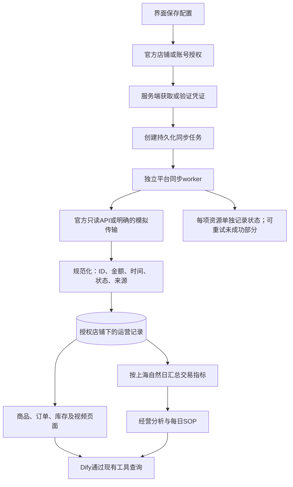

# 商家自研平台接入：现在准备，取得凭证后启用

更新：2026-10-19。

当前已经实现配置界面、服务端凭证加密、官方只读客户端、离线接口演练、同步队列、定时增量、失败重试及业务页面接入。没有真实店铺或账号凭证，因此真实平台授权、应用权限与实际账号返回尚未验收；离线测试不能代替这一步。

## 一、后续需要提供什么

| 接入对象 | 后续准备 | 启用方式 |
| --- | --- | --- |
| 自研抖店 | 已获准的商家自研应用、App Key、App Secret、平台店铺ID；平台侧完成应用与店铺授权 | 在“平台接入”填写并保存，点击“检查连接”，成功后“立即同步” |
| 抖音视频账号 | 具有对应数据能力的应用、Client Key/Secret、HTTPS授权回调地址 | 发起账号授权；或填写已取得的有效Access Token、Open ID及剩余有效期 |
| 平台未返回的商品事实 | 采购成本、尺码、颜色、面料等有依据的资料 | 同步后在“补充商品成本与规格”中填写，后续同步保留 |

系统不收集或模拟登录抖店/抖音账号密码。商家自研的店铺授权需先在官方平台完成；仅拥有Key/Secret或填写Scope不能代替权限申请及店铺/账号同意授权。

## 二、现在没有真实凭证时怎么检查

1. 打开运营工作台，进入“平台接入”。
2. 可先“新增平台接入”，选择正式接入，填写显示名称，保存待配置状态。未填写凭证时不会请求真实平台，也不能开始同步。
3. 点击“无凭证演练”，会创建独立的模拟店铺，通过本地HTTP模拟传输跑完整的原生响应解析、队列与数据落库流程。
4. 查看同步记录中的各资源状态；切换到该演练店铺，检查商品、订单、全店分析、SOP。
5. 可补充演练商品成本和规格，再次同步，检查补充资料仍保留。

演练为明确的`simulation`模式，真实连接绝不会因为网络错误、权限不足或响应异常而回退到模拟传输。演练数据按`is_demo=true`标记，不进入正式店铺的默认汇总。

## 三、正式接入步骤

### 1. 抖店商家自研

1. 在官方平台完成商家自研资质与应用申请，取得所需的商品、SKU、订单、售后读取权限。
2. 完成目标店铺对该应用的授权。
3. “新增平台接入”选择“抖店商家自研 / 正式接入”。
4. 填写店铺显示名、App Key、App Secret和平台数字店铺ID，保存。
5. 点击“检查连接”：后端使用`token.create`的`authorization_self`流程取得该店铺凭证，并检查返回的店铺ID是否匹配。
6. 点击“立即同步”，选择7/30/90天。凭证成功不等于每项业务权限可用，各资源会在实际同步时分别验证。
7. 与后台按相同自然日、支付及退款口径核对后，再开启定时同步。

同一店铺的凭证到期前会尝试重新取得自研凭证；授权失效时提示重新授权，不使用旧演示数字补数。所有金额在适配层按整数分处理。

### 2. 抖音视频账号

在已有平台店铺下新增“抖音视频账号”连接，可以将账号数据与店铺关联。正式和演练连接不能相互关联。

支持两种输入：

- 网站OAuth：保存Client Key、Secret、获批Scope和回调地址，点击“打开账号授权”；回调路径固定为`/api/platform/oauth/callback`，带10分钟、一次性的state校验。
- 已有API凭证：填写Open ID、Access Token及真实剩余有效秒数，可选Refresh Token。没有刷新条件时，到期后需要更新凭证；不能自动把平台账号密码变成Token。

当前视频客户端对应下表所列的官方OAuth视频列表和基础统计接口。不同应用载体、经营关系授权或升级版能力不保证复用相同接口；应根据实际获批能力验收。若平台要求另行进行经营扫码授权，需要先在平台完成。

生产授权回调需要使用平台认可、可访问的HTTPS域名；仅运行本地`localhost:8000`不能接收平台主动发送的服务端回调。代码可继续在本机开发，通过部署到对应域名后使用同一后端路由接入。

## 四、已实现的数据通路



平台同步与本地FFmpeg剪辑分为两个worker循环，不把平台同步排在长视频剪辑任务后面。当前仍按单API进程的本机部署设计，不可直接以多Uvicorn worker扩容；多实例需要另行引入独立进程与租约管理。

## 五、接口覆盖与指标边界

| 资源 | 已适配调用 | 下游用途 |
| --- | --- | --- |
| 自研凭证 | `token.create` | 按授权店铺获取和续期 |
| 商品与SKU | `product.listV2` → `product.detail`、`sku.list` | 规格、售价、库存、脚本事实上下文 |
| 订单 | `order.searchList`，按更新时间与分页读取 | 订单记录、交易汇总、发货风险 |
| 售后 | `afterSale.List` → `afterSale.Detail` | 退款记录、按退款时间统计金额与原因 |
| 视频列表 | `/video/list/` | 已授权账号作品信息 |
| 视频基础统计 | `/data/external/item/base/` | 最近创建视频的基础统计快照；按接口限制跳过超过30天的作品 |

订单与退款按更新时间增量补拉，默认回叠10分钟以覆盖边界变化，按外部ID幂等更新。扩大历史范围时执行相应补数。单轮限制90天和600次请求；达到限制会报告未完成，不把截断结果当成完整同步。

商品与SKU按当前列表扫描；其他数据源可以继续通过现有CSV/Excel导入。平台数据只保存业务投影，不保存返回的收货姓名、电话、地址等买家字段，不调用解密接口。

以下信息不能从订单明细推导或擅自填补：

- 访客与支付买家去重人数：缺失时为null，转化率不计算。
- 完播、商品点击、视频归因成交：基础统计接口没返回时保持未知。
- 采购成本、供货、质量观察和有效促销：需独立资料依据，不能从售价倒推。
- 同行后台数据、视频语音转写、画面语义、配音和视频发布：不属于本次账号/店铺数据同步。

本地日报是已同步交易明细的自然日汇总，不冒充罗盘全部指标。订单或退款覆盖不足时报告不完整；未成功同步的退款不能当成零退款。基本视频接口的统计按独立的近期窗口快照保存，不与日增量相加。

## 六、来源与会话隔离

- 新接入使用独立本地店铺ID，保留平台外部店铺和SKU标识。业务查询接受内部ID或授权范围内唯一的外部SKU。
- 存在正式店铺时，“全部”默认汇总正式店铺；演示店铺a/b和接口演练店铺仍可显式选择。
- 正式店铺不能点击“加载完整测试数据”，也不能导入`is_demo=true`的演示业务记录。
- 原商品、订单、旧经营接口在平台店铺范围内读取同步投影，不能回退到虚构店铺数字。
- 对话与工具上下文绑定数据范围指纹。新增正式店铺或切换来源后，不恢复旧范围的对话上下文。
- 编辑、同步、任务查询及补充商品事实均检查配置所有者及当前店铺授权；撤销本地membership后，既有配置也不可继续使用。

商品补充资料单独标记`operator_facts`与依据；同步时保留。默认不生成缺乏观察依据的选品分数。增加采购成本后可以显示毛利，但供货、质量或同规格竞品观察不足时仍列为资料不足。

## 七、故障与恢复

| 状态 | 行为 |
| --- | --- |
| 待填写配置 | 可保存，不调用真实API |
| 需要授权 | 停止相应连接，提示补权限或重新授权 |
| 资源部分失败 | 保留已提交的成功资源，单列未成功资源与错误类别 |
| 限流或临时网络错误 | 最多3次尝试，退避后重试，不重拉本任务已成功的资源 |
| 格式或关键字段不匹配 | 该资源不投影，显示契约错误，不能视为空列表 |
| 重复点击同步 | 返回正在排队或执行的同一任务 |
| 服务重启 | 中断的running任务恢复排队，从已成功资源后继续 |
| 手动断开 | 关闭定时任务、取消未执行任务、清理本地访问凭证，保留经营记录 |

“断开同步”不等于在平台撤销授权，平台授权管理中的撤销需要商家在平台操作。

## 八、凭证与迁移

凭证通过Fernet加密后存入数据库，API只返回是否已填写，不返回Secret、Access Token或Refresh Token。平台密钥不进入Dify、浏览器持久化或公共DSL。

默认首次需要加密时自动生成`.runtime/platform-encryption.key`，该目录不进Git。也可通过`PLATFORM_ENCRYPTION_KEY`提供Fernet密钥。迁移数据库时必须同时保留原加密密钥；丢失后需要重新填写或授权，不能静默重新解密成功。

平台同步开关：`PLATFORM_WORKER_ENABLED=true`，默认开启。定时同步只在服务运行期间执行。正式凭证建议在“平台接入”页面填写，不要提交到代码仓库。

## 九、复验与首次真实验收

离线回归：

```bash
.venv/bin/python -m pytest -q
PATH="$PWD/.runtime/node/bin:$PATH" npm --prefix frontend run build
.venv/bin/python scripts/start.py --restart
.venv/bin/python -m tests.scripts.browser_platform_smoke
```

浏览器脚本创建临时运营账号、待配置正式连接和接口演练连接，检查后清理；不导入真实数据、不调用真实抖店/抖音API、不调用模型。结果位于`tests/artifacts/reports/platform-browser-report.json`，截图位于`tests/artifacts/screenshots/platform-*.png`。

真实账号首次接入必须另外确认：

1. 应用和店铺/账号授权有效，权限包覆盖实际调用。
2. 各接口返回字段、订单状态、父子订单、金额单位与本地适配契约一致。
3. 以相同时间段核对商品数量、支付金额、退款完成金额和数据更新时间。
4. 明确未开放指标，页面显示未知而非虚构数值。
5. 验证凭证到期、权限撤销、限流和补数。

本轮离线结果：95项后端回归通过，平台接入浏览器8项通过，原运营页面浏览器13项通过，两个浏览器报告均无JavaScript错误；TypeScript与Vite构建通过。7个本地Dify应用已更新发布，公开文件凭证扫描通过。本轮没有调用真实抖店/抖音API或模型；临时浏览器账号与接入数据已清理。汇总见`tests/artifacts/reports/platform-readiness-report.json`。

## 十、官方依据与实现位置

- [商家自研入驻要求](https://op.jinritemai.com/docs/question-docs/90/7166?from=list)
- [自用型与工具型应用](https://op.jinritemai.com/docs/guide-docs/127)
- [自用型店铺授权](https://op.jinritemai.com/docs/guide-docs/9/21)
- [API调用与签名](https://op.jinritemai.com/docs/api-do/148/814)
- [订单查询](https://op.jinritemai.com/docs/api-docs/15/521)
- [抖音授权账号视频列表](https://open.douyin.com/platform/resource/docs/openapi/video-management/douyin/search-video/account-video-list)
- [视频基础统计与限制](https://open.douyin.com/platform/resource/docs/openapi/data-open-service/video-data/get-basic-data/)

主要实现：`backend/commerce/platform_api.py`、`platform_client.py`、`platform_service.py`、`platform_mapping.py`、`platform_data.py`、`platform_vault.py`和`platform_fixtures.py`，界面为`frontend/src/PlatformConnections.vue`。自动化回归位于`backend/tests/test_platform.py`与`tests/tests/scripts/browser_platform_smoke.py`。
