# 当前运营 Agent：功能、实际流程与优化核对

> 2026-10-20补充：已增加栏目独立会话和现有页面功能的聊天适配器。本文下方的19读/4写清单及“仅页面可达”说明为旧版核对；新增功能、表单边界与验证见[栏目会话与聊天工具](栏目会话与聊天工具.md)。

> 2026-10-19补充：已新增商家自研平台接入、独立模拟传输与自动同步。本文保留此前业务流程核对，新增数据来源与启用步骤以[商家自研平台接入](商家自研平台接入.md)为准。

核对日期：2026-10-18。依据当前仓库源码、Dify DSL、工具契约和前端调用关系编写。本文是静态实现分析，没有重新执行真实模型请求、导入或剪辑；已有验收结果请参阅根目录 README 链接的对应报告。

当前产品仅服务运营人员。旧消费者、商家入口，以及售后申请、商品上架、独立问题跟进和效果复盘模块均已移除。每日 SOP 的任务回填仍存在，不等于已移除的独立问题跟进模块。

## 1. 总体架构与能力清单

当前是“一个运营 Chatflow + 六个可调用 Workflow + Python 业务服务 + 本地后台 worker”。模型通过 Dify 调用 DeepSeek。

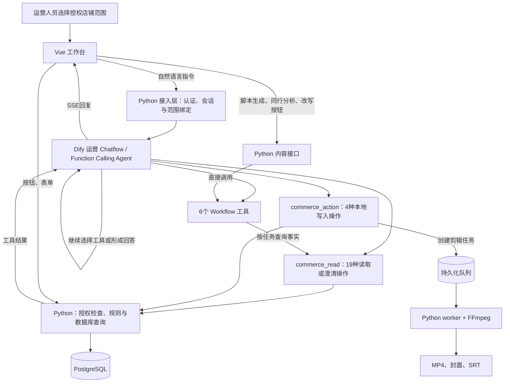

图中的 Agent 循环是架构概览，不表示每次都调用全部工具。普通按钮操作可以直接调用 Python；并不是所有固定流程都由 Dify 实现。SOP、导入、统计、事实检查和剪辑队列的固定规则主要在 Python 中。

| 功能 | 主要输入 | 主要产出 | 页面 / 聊天可达性 |
| --- | --- | --- | --- |
| 报表导入与字段映射 | CSV、JSON、JSONL、XLSX | 已校验、去重的运营记录 | 页面；没有导入专用 Agent 工具 |
| 全店经营诊断 | 店铺、周期、日报、订单、退款、库存 | 指标、异常、事实与行动建议 | 页面统计；聊天分析 |
| 每日 SOP | 已导入模板、日期、经营快照 | 当日任务 | 页面、聊天、后台定时 |
| 任务回填与日报 | 任务版本、负责人、状态、说明、证据 | 更新记录、任务日报 | 页面、聊天；日报保存走页面 |
| 商品筛选与对比 | 预算、品类、尺码、面料、SKU | 商品事实与对比 | 页面、聊天 |
| 订单和售后记录 | 授权店铺范围 | 最近订单、售后只读记录 | 页面、聊天 |
| 选品与竞品研究 | 品类、售价、毛利门槛、竞品快照 | 规则评分、缺资料候选、解释 | 页面、聊天；快照导入走页面 |
| 短视频表现分析 | 视频清单、视频日指标 | 播放、点击、完播、归因支付与提示 | 页面、聊天 |
| 素材上传与预览 | 本地视频、店铺、款式ID | 媒体文件、元数据 | 页面；聊天可以读取已有素材上下文 |
| 同行拆解 | 用户提供的转写、可选本地参考视频 | 钩子、结构、卖点依据、改编建议 | 页面完整流程；聊天调用分析 Workflow |
| 可剪辑脚本 | 本店商品、素材、可选同行参考、创作要求 | 分镜、截取时间、字幕、脚本版本 | 页面、聊天 |
| 脚本文案检查与改写 | 当前脚本、当前商品资料、锁定标记 | 问题清单、单轮改写候选、差异预览 | 页面专用接口；未挂成独立 Agent 工具 |
| 自动剪辑与下载 | 已保存脚本、版本 | 本地成片、封面、SRT、任务状态 | 页面、聊天；失败重试走页面专用接口 |
| 营销文案、报告保存 | 商品事实、创作要求、助手回复 | 营销草稿、经营报告 | 聊天生成，页面保存 |
| 知识问答 | 问题、public/internal范围 | 检索片段、来源信息、回答 | 聊天；页面支持查看已有引用 |
| 对话与运行记录 | 账号、店铺范围、历史会话 | 流式回复、历史恢复、错误提示、审计 | 页面与后端 |

## 2. 聊天请求如何执行

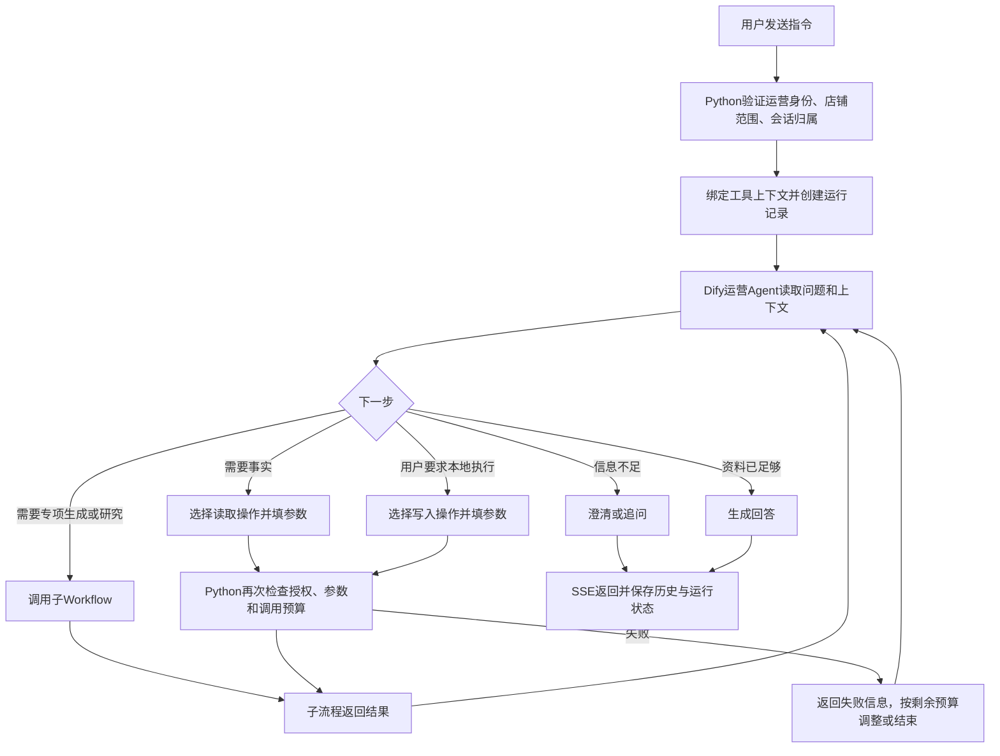

- 主 Agent 最多5次迭代。选品研究、经营分析两个子 Agent 也各配置5次迭代。
- 同一聊天请求的业务工具调用共用后端8次上限，嵌套 Workflow 内的业务调用也计入；这不等于所有模型节点合计只有5次运行。
- `commerce_read` 提供19种操作，`commerce_action` 提供4种操作，另有6个 Workflow 工具；顶层 Agent 实际挂载的是8个工具入口，不能说成29个独立工具。
- 自然语言执行本地写入时，当前提示词以用户的执行要求为授权，不设置统一的二次确认画布；后端继续做范围、参数和版本校验。改写候选的采用另有明确按钮。
- 失败消息支持用户重试，断流保留部分正文；重试会重新发出请求。不能把回复失败理解为之前的工具写入必然回滚。

实现：[聊天接入](../../backend/commerce/main.py)、[顶层 Chatflow](../../dify/chatflows/operator.yml)、[工具执行分发](../../backend/commerce/ops_tools.py)。

## 3. 报表导入、Excel与字段映射

**用途：** 将人工取得的运营报表转成系统可分析的记录。当前没有自动拉取抖音后台的步骤。

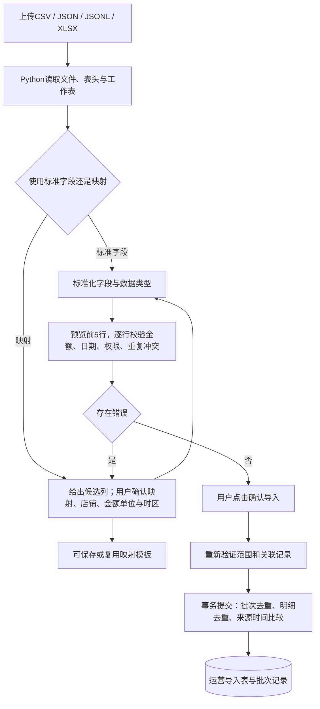

**关键规则：** 金额统一为整数分；未知可空字段不自动补零；无时区时间按所选上海或UTC转换；Excel公式、错误单元格和可能丢精度的长数字ID被拒绝。有错误时不部分入库，切换映射或单位后必须重新预览。

**核对与优化：** 先用真实平台导出样例确认字段含义及状态映射，再保存为模板。当前是通用映射能力，不能据此称已适配所有抖店报表版本。

实现：[文件与映射](../../backend/commerce/ops_imports.py)、[标准化与提交](../../backend/commerce/ops_data.py)、[导入页面](../../frontend/src/ReportImporter.vue)。

## 4. 全店经营分析

**用途：** 分析成交、期间退款、净收款、父子订单、流量转化，并核查缺报、低库存、超时未发货和对账差异。

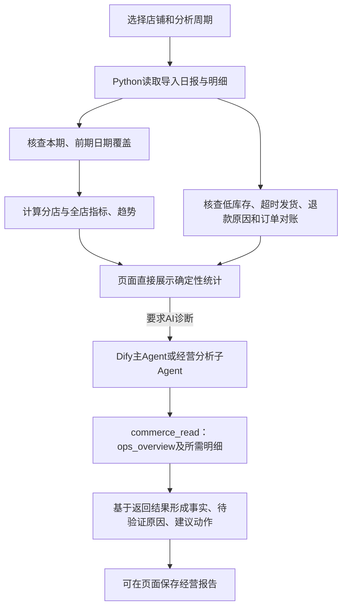

**关键规则：** 默认按数据截至日之前的完整自然日分析；缺报时说明仅为已覆盖日期小计，当前或前期缺报时不输出完整周期环比；转化是买家日/访客日，非跨日去重人数；净收款不等于利润。低库存当前规则为近7日销量大于可售库存，不包含采购提前期预测。

**核对与优化：** 当前同时保留两个指标入口：`ops_overview` 使用新导入报表，`analytics` 使用原有 apparel-v1 订单。两者来源与时钟不同，应在界面、输出中明确来源，并优先统一分析入口。导入演示数据有固定截至时间，旧查询仍使用当前时间；相同“最近7天”可能指向不同周期。

实现：[新经营统计](../../backend/commerce/ops_data.py)、[旧经营统计](../../backend/commerce/business.py)、[经营分析 Workflow](../../dify/workflows/business-analysis.yml)。

## 5. 每日 SOP、任务回填与日报

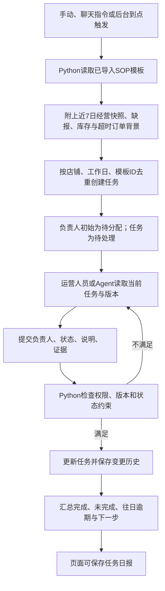

**关键规则：** 重复生成不重置既有任务；完成必须有证据，阻塞必须有原因；乐观版本检查防止覆盖并发编辑。任务支持待处理、进行中、阻塞、待验收、已完成、已取消。日报汇总不会自动关闭任务。

**定时方式：** Python worker 在服务运行期间按上海时区检查各店配置的小时。当前与剪辑共享本地 worker，并不是独立生产调度平台；服务未运行时不能按点执行。

**核对与优化：** 当前 SOP 是“模板实例化 + 附加经营背景”，不是模型根据异常自动编排任务；标题来自模板，负责人初始待分配。任务优先级当前主要由数据是否完整决定。后续可明确哪些异常应增加哪类任务、如何分派，再决定是否交给模型。

实现：[任务规则与日报](../../backend/commerce/ops_work.py)、[本地定时](../../backend/commerce/ops_worker.py)。

## 6. 商品资料、订单与售后只读查询

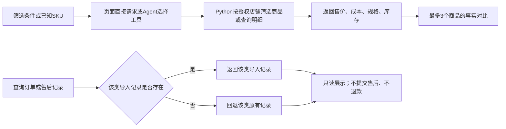

商品搜索、详情、对比通过 `products`、`product_detail`、`compare`；订单与售后通过 `orders`、`after_sales`。上图的回退是条件分支：有导入记录时直接返回导入记录，不合并两套订单。

**核对与优化：** 商品资料/选品查询主要仍使用原商品表；视频脚本读取的是导入运营商品表。需要核对同一SKU的价格、面料、库存及更新时间是否一致。订单与售后也应分别显示来源，避免“订单已导入、退款尚未导入”时混读旧来源。

实现：[商品、订单与售后查询](../../backend/commerce/business.py)、[商品查询 Workflow](../../dify/workflows/product-match.yml)。

## 7. 选品研究与竞品对比

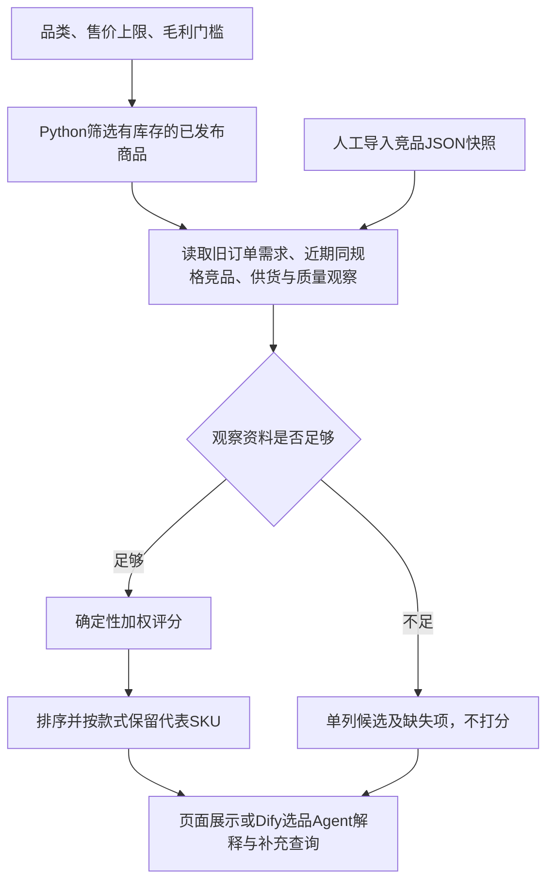

评分权重为需求30%、毛利25%、竞争20%、供货15%、质量10%。资料要求包括近30天需求样本、至少3条7天内同规格竞品、供货观察和至少20单质量观察。模型负责解释和按需查询，不计算或修改评分。

**核对与优化：** 这是对既有商品的规则排序，尚无外部市场发现或实时竞品抓取。来源仍主要为 apparel-v1，且有30天/7天时间窗口；随着演示记录变旧，候选可能进入资料不足，核对时要同时看样本日期。供货与质量观察目前含合成字段，不能视为真实预测能力。

实现：[选品与竞品](../../backend/commerce/business.py)、[选品 Workflow](../../dify/workflows/selection-research.yml)。

## 8. 短视频指标分析

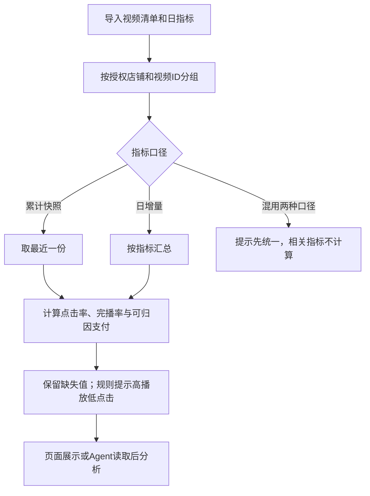

**关键规则：** 没采集完播次数时完播率是未知；无播放分母不计算比率。当前高播放低点击提示阈值为播放不少于10万且点击率低于1%。

**核对与优化：** 当前聚合主要覆盖该视频已导入记录，没有完整的视频分析周期参数。后续可增加明确的区间和来源范围，再考虑同品类基线、内容分组和更细归因。视频指标分析与同行内容拆解是两条不同链路。

实现：[视频聚合](../../backend/commerce/ops_data.py)、读取操作 `ops_videos`。

## 9. 素材与同行拆解

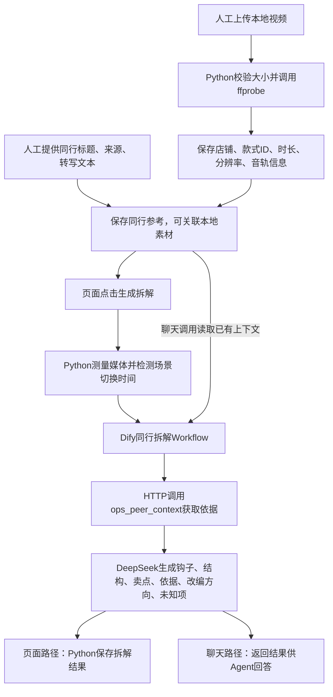

**关键规则：** 上传上限64MB、素材时长不超过180秒。内容理解依赖用户提供的字幕/转写；FFmpeg仅测时长和场景切换，不提供语义画面理解或语音转写。

**两条路径的差别：** 页面 `/peers/{id}/analyze` 包含媒体测量和结果持久化；聊天直接调用 `peer-analysis` Workflow 只读取已保存的参考上下文并返回分析，不能假设它自动补做相同测量或保存分析记录。

**预留能力：** `/api/ops/videos/parse` 的解析适配器目前为未配置实现，返回501；并未接通“粘贴视频网址 → 自动提取字幕”。它也未挂进 Agent 工具列表。

**核对与优化：** 优先统一页面和聊天的同行分析入口，使测量、依据标记与保存行为一致；如要支持链接输入，再接解析和转写，并保留来源与置信信息。

实现：[素材与同行业务](../../backend/commerce/ops_media.py)、[同行 Workflow](../../dify/workflows/peer-analysis.yml)、[视频解析占位](../../backend/commerce/video_parser.py)。

## 10. 生成可剪辑脚本与人工编辑

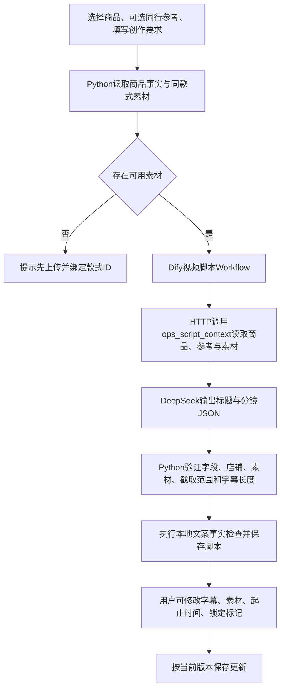

每段包含 `asset_id`、`in_seconds`、`out_seconds`、`caption`，可含锁定标记。后端允许1～20段，总时长1～180秒；生成提示词优先3段不同素材，每段字幕不超过50字，保存接口上限为100字。

**聊天路径：** 主 Agent 可调用 `wf_video_script` 取得结构化结果，再调用 `commerce_action / ops_script_save` 保存。页面 `/scripts/generate` 则由 Python 调用 Workflow、校验并保存，生成成功即落库；两者不能把“生成文本”与“已保存脚本”混为一谈。

**核对与优化：** 当前所谓脚本版本主要是版本号与并发控制，修改会替换脚本行的当前 payload；已排队剪辑冻结原版本快照，但尚无完整的逐版脚本历史与任意回滚接口。还需人工确认素材画面是否配合字幕，模型没有直接看视频语义。

实现：[脚本生成与保存](../../backend/commerce/ops_media.py)、[视频脚本 Workflow](../../dify/workflows/video-script.yml)。

## 11. 文案事实检查与定向改写

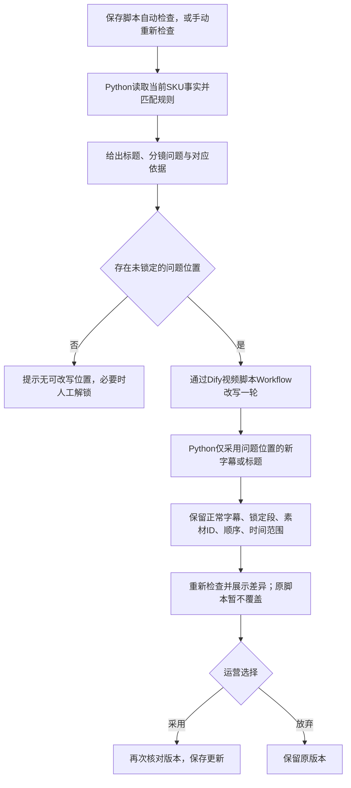

**覆盖范围：** 价格、面料成分及含量、当前SKU尺码、促销和常见性能承诺。事实检查是本地规则，不调用模型；改写复用 `video-script`，没有独立第7个 Workflow。

**关键边界：** 未命中规则不代表全部事实已验证；锁定内容仍可报告问题，只是不自动修改。当前检查结果主要是提示，剪辑入队并未以“问题清零”为强制条件。

**核对与优化：** 明确哪些问题只需提示、哪些问题应在导出前要求核对；如需在聊天中直接使用这项能力，应新增明确工具或统一业务入口，目前并没有专用检查/改写操作可选。

实现：[规则检查](../../backend/commerce/ops_content.py)、[改写与保护](../../backend/commerce/ops_media.py)、[差异采用界面](../../frontend/src/ScriptReview.vue)。

## 12. 自动剪辑、状态查询与失败恢复

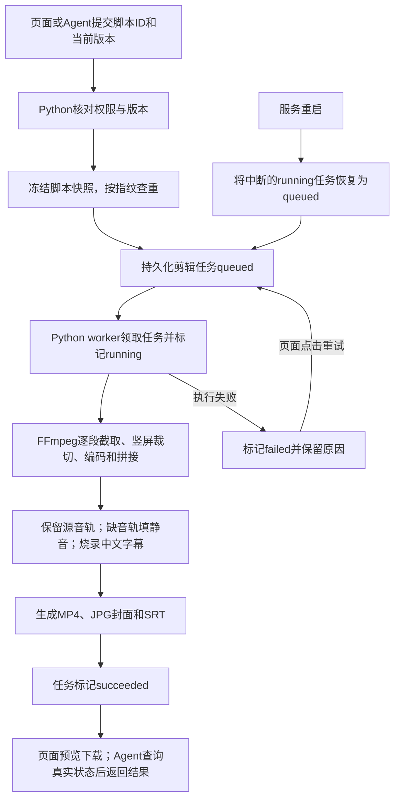

输出为360×640、24fps竖屏；生成素材不等于真人实拍，不生成配音，不替换背景音乐，不自动发布抖音。相同脚本版本与内容会命中已有任务；需要重试失败任务时使用页面专用重试接口，单纯再次调用 `ops_render` 可能只返回已有失败任务。

**核对与优化：** 当前后台按单API/worker进程设计，SOP和剪辑共享执行循环，较长剪辑可能推迟SOP检查。后续若需要持续批量剪辑，可独立worker及调度，并补充任务进度、取消、清理和明确的重试策略。

实现：[入队与FFmpeg](../../backend/commerce/ops_media.py)、[领取与恢复](../../backend/commerce/ops_worker.py)、[重试与产物读取](../../backend/commerce/ops_api.py)。

## 13. 营销文案、知识问答与历史

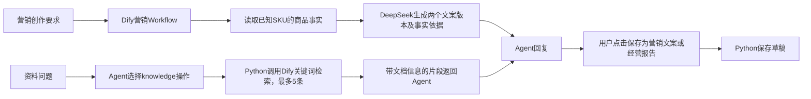

- 营销 Workflow 只生成，不自动保存或发布。当前 `commerce_action` 的4种写操作不包含营销文案/报告保存；该保存通过页面 `/api/content` 完成。
- 知识查询允许public/internal，内部资料只向运营角色开放。检索是关键词检索，无Embedding、混合检索与Rerank。
- 历史会话按账号和店铺范围恢复；新回复与运行状态持久化，支持加载更早消息与失败重试。工具审计记录与聊天记录分别保留。
- 检索工具返回来源字段，并不等于每次 Agent 回答都会自动出现可点击引用卡片；前端卡片当前依赖Dify最终消息中的引用元数据，核对时应检查实际回复。

实现：[营销 Workflow](../../dify/workflows/marketing-draft.yml)、[知识访问](../../backend/commerce/knowledge.py)、[历史与保存](../../backend/commerce/main.py)、[前端会话](../../frontend/src/App.vue)。

## 14. 六个 Dify Workflow 的真实节点

| Workflow | 当前节点顺序 | 是否由模型自主选择下一步 |
| --- | --- | --- |
| product-match | Start → Code构造products参数 → HTTP业务查询 → End | 否，确定性查询流程 |
| marketing-draft | Start → Code构造product_detail参数 → HTTP → LLM生成文案 → End | 否，固定生成流程 |
| video-script | Start → Code构造ops_script_context参数 → HTTP → LLM输出脚本JSON → End | 否，固定生成流程 |
| peer-analysis | Start → Code构造ops_peer_context参数 → HTTP → LLM输出拆解JSON → End | 否，固定生成流程 |
| selection-research | Start → Function Calling Agent，仅挂commerce_read → End | 是，受限读取循环 |
| business-analysis | Start → Function Calling Agent，仅挂commerce_read → End | 是，受限读取循环 |

顶层 Chatflow 则是 Start → Function Calling Agent → Answer。没有单独的意图分类节点再强制进入对应业务分支；由主 Agent 在8个工具入口中选择。六个子流程也不是必须依次执行的固定大流水线。

## 15. 工具清单与优化优先级

`commerce_read` 的19种操作：

| 类别 | 操作 |
| --- | --- |
| 商品、选品、竞品 | products、product_detail、compare、selection、competitors |
| 订单与售后 | orders、after_sales |
| 经营 | analytics（原数据）、ops_overview（导入报表） |
| 视频、参考与素材上下文 | ops_videos、ops_peers、ops_peer_context、ops_script_context |
| 任务与日报 | ops_tasks、ops_report |
| 脚本与剪辑任务 | ops_scripts、ops_jobs |
| 知识与追问 | knowledge、clarify |

`commerce_action` 的4种操作：ops_sop_generate、ops_task_update、ops_script_save、ops_render。

另外6个 Workflow 工具：wf_product_match、wf_marketing_draft、wf_selection_research、wf_business_analysis、wf_video_script、wf_peer_analysis。

下表为根据代码关系提出的优化建议，不代表已经实施：

| 优先级 | 待核对项 | 预期改善 |
| --- | --- | --- |
| 1 | 统一旧商品/订单与导入运营表的来源、SKU关联和分析时钟 | 同一问题的页面和聊天数字可解释、可对账 |
| 2 | 同行分析、脚本生成、检查与重试的页面入口和Agent入口统一业务语义 | 避免聊天只返回内容而页面还执行了测量、校验和保存 |
| 3 | 为多步内容任务明确阶段与结果状态，检查5次迭代/8次业务调用是否足够 | 避免生成、保存、排队、查询状态混淆或执行到一半耗尽预算 |
| 4 | 明确SOP模板、异常触发、优先级、分派规则及任务状态约束 | 从每天固定清单发展为可核查的运营执行流程 |
| 5 | 增加脚本历史快照与回滚，明确文案问题到导出的处理规则 | 便于审阅、对比和恢复已采用的改写 |
| 6 | 用真实报表与真实素材验证导入模板和产物效果；按需求接网址解析/转写 | 将当前本地演示链路扩展到实际运营输入 |
| 7 | 拆分剪辑worker与定时SOP，完善进度、失败重试与容量观测 | 批量执行时状态可靠，调度不被长任务拖延 |

## 16. 核对时建议逐项回答的问题

1. 业务目标是分析建议、生成草稿，还是要落库/排队执行？每一步的成功证据是什么？
2. 页面和聊天对同一功能，是否使用相同的数据来源、周期和业务入口？
3. 数据不足时，是追问、停止还是输出待验证项？有哪些字段绝不能由模型补造？
4. SOP任务哪些来自固定模板，哪些应来自异常？负责人和优先级按什么规则确定？
5. 生成脚本后需要怎样的人工审阅？锁定、采用、版本冲突和回滚是否符合预期？
6. 剪辑返回的是排队状态还是实际成片？失败后从哪里恢复，是否重复执行已成功步骤？
7. 最终回答是否能关联到具体报表、商品、任务、脚本、剪辑任务和知识依据？

