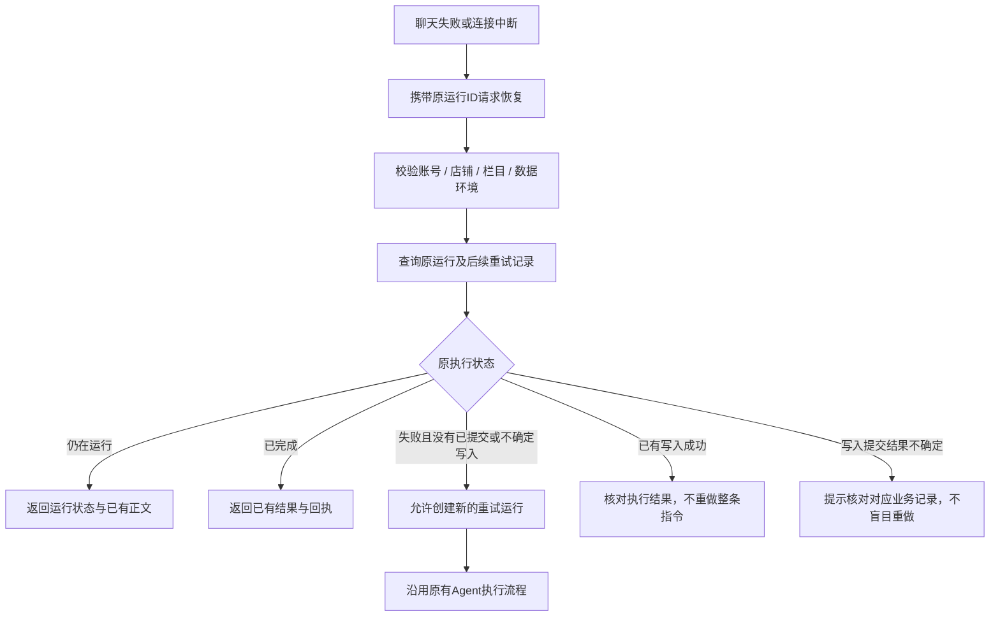
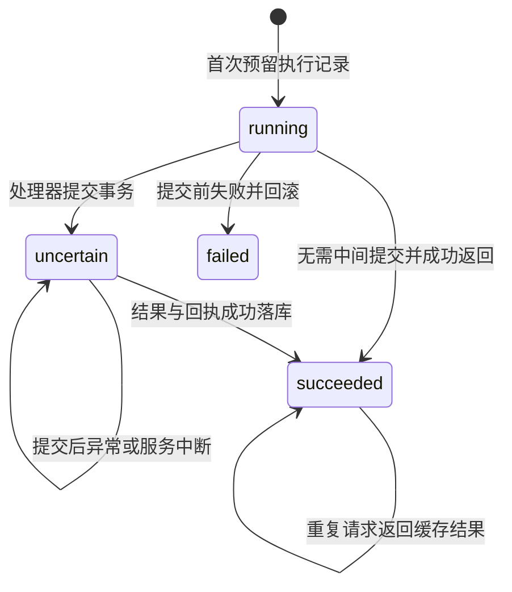

# 错误恢复与兜底

更新：2026-10-25。

本次在原有业务流程外增加请求去重、写操作执行记录、结果核对、流式回复检查点和聊天超时回收。业务统计口径、页面业务接口、Dify 工作流、平台同步及剪辑规则保持原实现。

## 1. 聊天失败后如何恢复

### 页面行为

- 没有已提交或结果不确定的写操作时，失败消息提供“重试这条消息”。
- 已有操作完成或提交结果不确定时，提供“核对执行结果”，展示已有回执和资源 ID。
- 核对已有结果不调用 Dify，也不重新执行业务工具；Dify 尚未绑定或暂不可用时仍能读取已有结果。
- 同一个原消息曾经重试过，会继续核对它的后续重试记录，避免再次点击原消息导致重复写入。
- 重新输入并发送一条新指令仍表示新的用户请求，不按问题文本全局去重。

### 可选请求字段

`POST /api/chat` 新增两个可选字段，旧客户端不传时仍可按原协议发送普通消息：

| 字段 | 用途 |
| --- | --- |
| `client_request_id` | 客户端为一次发送生成的请求标识；同账号重复提交同标识时返回原运行，内容或范围不匹配则拒绝 |
| `retry_of` | 原运行 ID；后端先判断能否安全重试，不由前端决定是否重新执行 |

前端在第一帧到达前断流、尚未获得运行 ID 时，会保留客户端请求标识供下一次核对。请求恢复继续执行店铺、栏目和数据来源范围校验。

## 2. 工具写入保护

### 去重范围

工具执行记录按“本轮运行 ID + 操作名 + 排序后的参数摘要”唯一标识，不重复存储完整输入参数。只作用于具备本地聊天运行记录的写工具；独立 Workflow 上下文继续使用原有业务契约。读取工具不使用结果缓存。

- 已成功的同轮同参数写操作直接返回原结果，不重复占用 8 次工具调用额度。
- 正在执行或提交结果不确定时拒绝重复写入。
- 参数不同的写操作仍通过原来的校验、版本和权限规则执行。
- 并发重复调用由数据库唯一约束保护。
- 工具调用前仍执行认证、上下文有效性、栏目与店铺范围校验，缓存不能绕过权限。

### 为什么保留 uncertain

原有业务处理器可能多次提交事务，例如先获取模型上下文，再保存业务结果。本次不改这些业务事务边界，而是在处理器每次提交时，将工具记录同时标记为 `uncertain`；处理器完整返回后，再持久化成功结果和执行回执。

因此，“业务已经提交、成功回执尚未写入”期间发生故障时，系统不会错误地认为该操作未执行。仅提交元数据也可能保守地进入待核对状态。这里保证的是避免盲目重复执行，不承诺跨进程、跨外部平台的全局恰好一次执行。

结果不确定时，需要到报告、任务、脚本、同步记录等对应业务页面核对。当前没有自动推断业务成功、自动撤销、自动补偿或人工强制重放接口。

## 3. 流式检查点与超时回收

- 聊天过程中约每 0.75 秒按收到的上游事件保存已处理的正文、引用和更新时间，正常结束时保存最终结果。
- 进程突然退出时，可以恢复最近一次已提交的检查点；检查点间的最新片段可能丢失，不能等同于逐字持久化。
- 后台每 15 秒巡检长期未更新的聊天运行；读取运行记录和发起聊天时也会检查当前账号的过期运行。
- 默认 300 秒未更新后标记为 `interrupted`，保留正文与执行回执，并使该运行的工具令牌失效。
- `CHAT_RECOVERY_SECONDS` 可配置为 240～3600 秒；该值用于过期回收，不改变原有模型调用的 120 秒总时限。
- 回收只结束本地等待状态，不保证已停止外部模型计算。晚到的新业务提交仍受运行状态和写入保护校验。
- 正常执行中的请求不会在服务启动时被一律重新执行。

## 4. 保留的原有恢复措施

| 模块 | 原有措施 |
| --- | --- |
| 平台同步 | 可恢复错误有限退避重试、资源级提交、保留部分成功、跳过已完成资源、重启恢复队列 |
| 视频剪辑 | 冻结脚本快照、指纹去重、持久化任务、失败重试、单机重启后重新排队 |
| 记忆任务 | 租约领取与回收、有限重试、失败终态、失效来源与权限校验 |
| 记忆检索 | 向量不可用时保留关键词检索结果，并返回降级状态 |
| 上下文 | 响应式压缩；满足尚未输出答案、尚未调用工具等条件时允许一次超限重试 |
| 基础业务页面 | 模型未绑定时仍可使用原有商品、订单、导入等直接业务接口 |

没有新增自动切换模型、绕过授权、填造缺失业务数据或失败后切换模拟数据。平台同步和剪辑仍保留原有单机部署边界。

## 5. 存储与协议变更

均为增量变更，现有表和历史记录不删除：

- `chat_runs` 新增 `updated_at`、`client_request_id`、`retry_of`。
- 按账号及非空 `client_request_id` 增加唯一索引；旧记录该字段为空，不受限制。
- 新增 `tool_executions` 表，存储写操作参数摘要、状态和成功结果。
- 运行记录与 SSE 新增 `recovery` 信息，包含业务执行状态、是否可重试、错误分类和核对提示。
- 原有 SSE 事件保留；重复请求的 `start` 事件额外标记 `replayed`。

新增表和列由原有 `initialize_schema()` 在 API 正常启动时创建。上线前先备份数据库，再按原启动方式重启 API；本次离线测试不会代替真实环境迁移或平台联调。

## 6. 验证范围

专项回归位于 [test_recovery.py](../../backend/tests/test_recovery.py)，使用隔离的 PostgreSQL schema、模拟模型输出和真实业务处理器，覆盖：

- 相同请求标识重放、跨账号/店铺/栏目隔离及内容绑定。
- 无写入失败后的安全重试，以及重复点击原消息时对后续重试的核对。
- 业务写入成功后回复失败，恢复时不重复执行。
- 同轮重复写入、并发重复写入、提交前回滚和提交后不确定状态。
- 过期运行回收、令牌失效、正文检查点保留和迁移重复执行。
- 桌面和手机浏览器中的失败提示、执行回执、结果核对与刷新恢复。

测试不调用真实模型或真实平台。浏览器截图与测试报告放在 `tests/artifacts/`，它们仅证明对应的离线验证范围。

实现入口：[recovery.py](../../backend/commerce/recovery.py)、[main.py](../../backend/commerce/main.py)、[models.py](../../backend/commerce/models.py)、[db.py](../../backend/commerce/db.py)、[App.vue](../../frontend/src/App.vue)、[api.ts](../../frontend/src/api.ts)。
