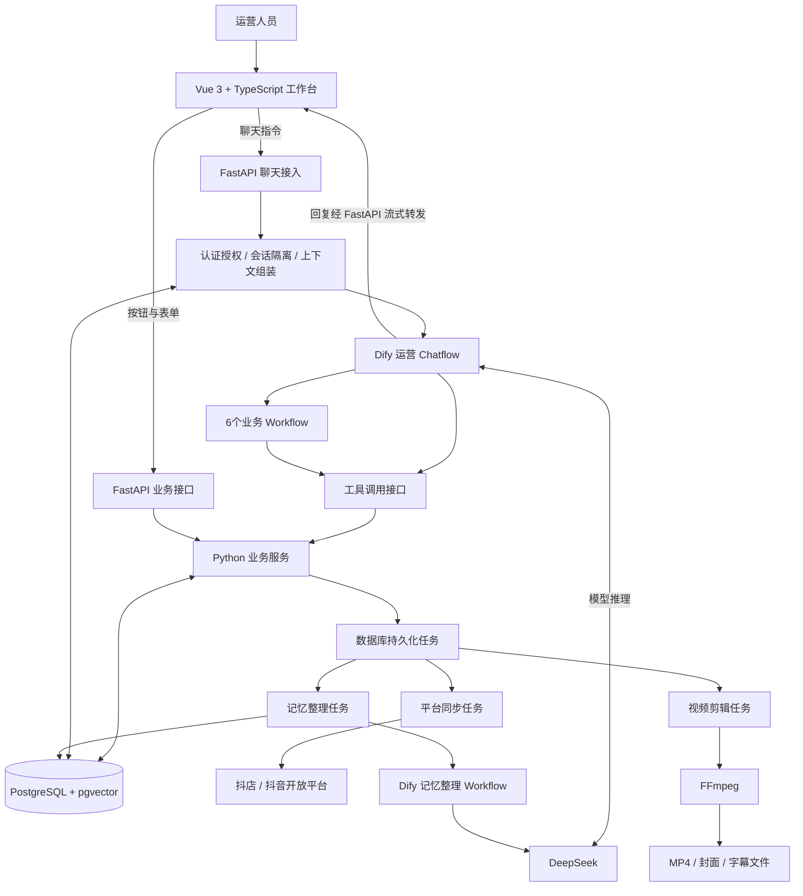
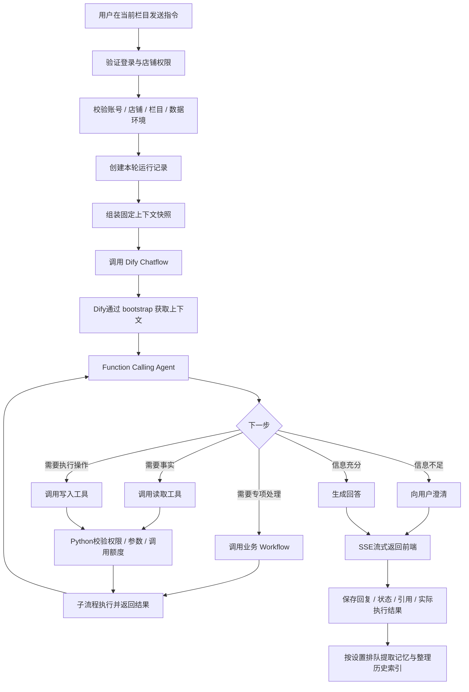
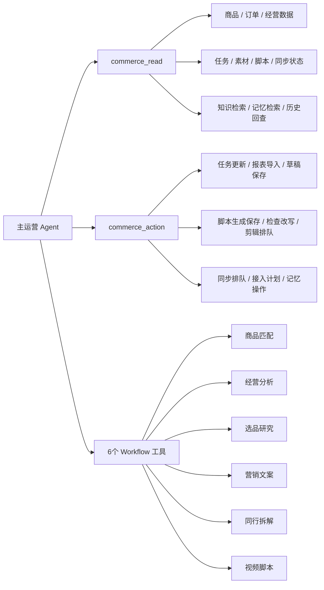
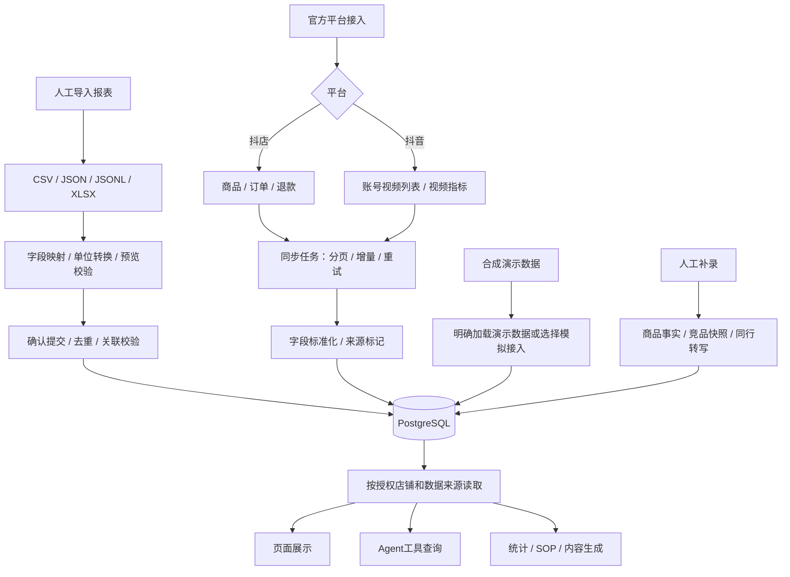
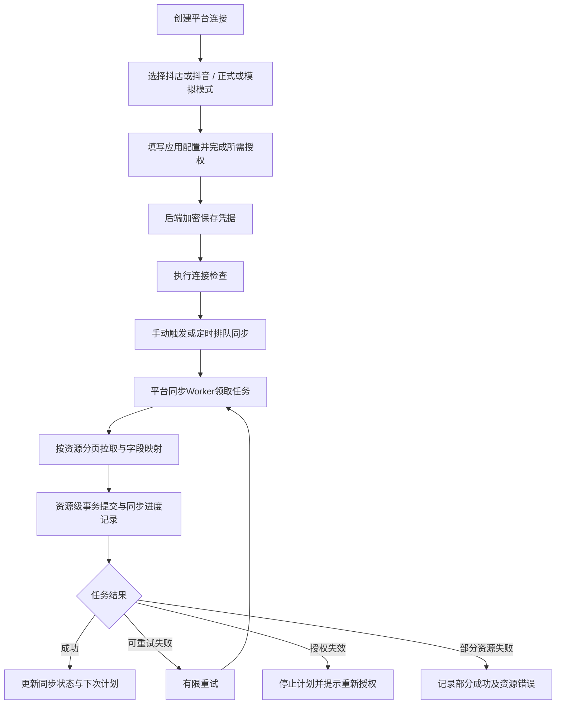
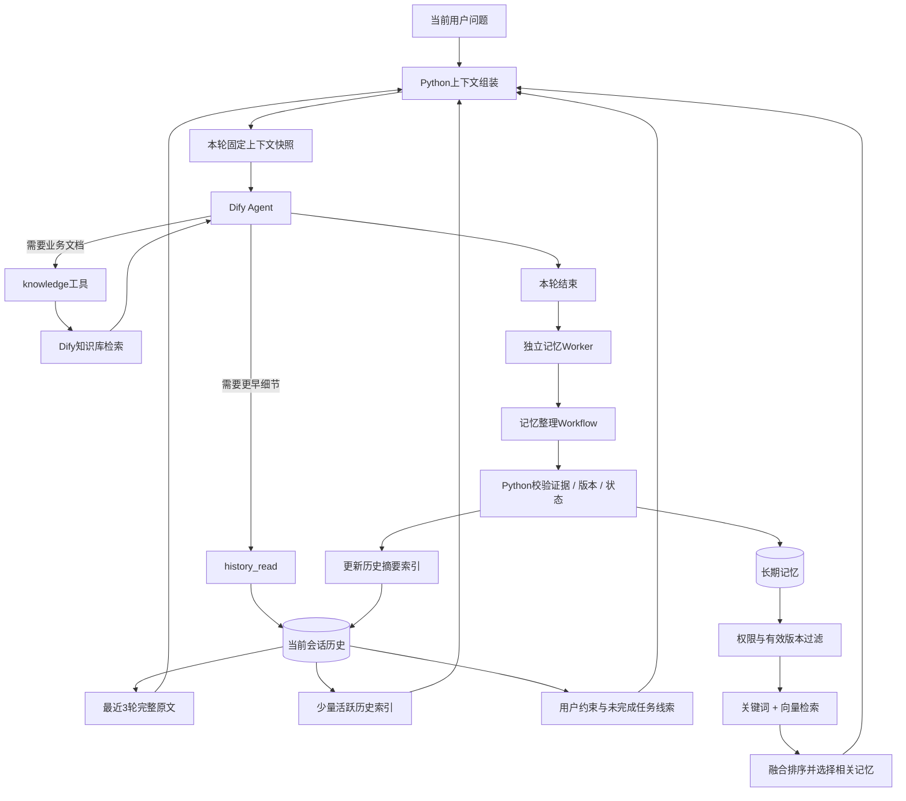
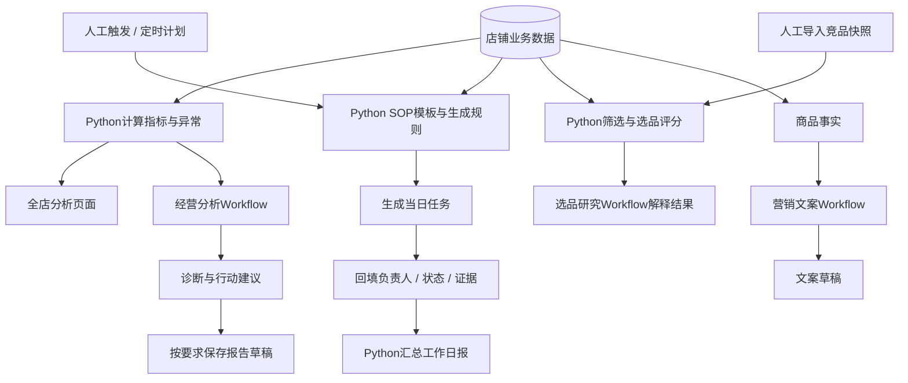
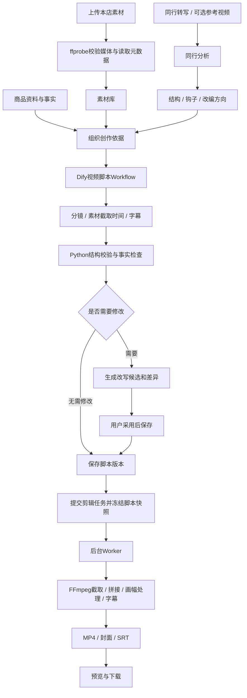
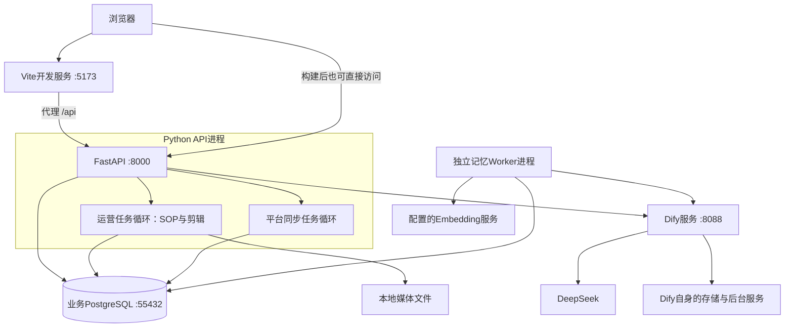

# 衣序 · 抖店运营 Agent 项目架构图解

核对日期：2026-10-23。

2026-10-25 增补：已在原业务流程外增加请求去重、写操作执行记录、结果核对、流式检查点与聊天超时回收，详见[错误恢复与兜底](错误恢复与兜底.md)。下文保留原架构核对日期，恢复设计以增补文档为准。

本文依据当前仓库源码、Dify DSL、工具契约和配置清单整理，供架构核对与后续优化使用。本次只做静态分析，没有重新运行模型、平台同步或视频剪辑，也没有验证真实店铺授权。文中“已实现”表示代码中存在对应实现，不代表已完成生产环境验收。

流程图使用 Mermaid；需要支持 Mermaid 的 Markdown 阅读器才能显示为图形。

## 阅读导航

1. [整体架构与职责](#1-整体架构与职责)
2. [聊天与 Agent 执行链路](#2-聊天与-agent-执行链路)
3. [工具与 Dify 工作流](#3-工具与-dify-工作流)
4. [数据来源与平台接入](#4-数据来源与平台接入)
5. [上下文、长期记忆与知识库](#5-上下文长期记忆与知识库)
6. [经营分析、SOP 与内容功能](#6-经营分析sop-与内容功能)
7. [短视频生产链路](#7-短视频生产链路)
8. [部署结构与存储](#8-部署结构与存储)
9. [能力边界与优化核对](#9-能力边界与优化核对)

## 1. 整体架构与职责

项目整体由 **Vue 运营工作台、FastAPI 业务后端、Dify Agent 编排、PostgreSQL 数据与记忆、Python 后台任务**组成。

Dify 负责模型侧的决策与内容生成；Python 负责数据处理、权限、统计、同步、业务状态和剪辑。固定流程分布在 Dify 与 Python 两侧，并非全部由 Dify 实现。

| 层次 | 主要职责 | 关键入口 |
| --- | --- | --- |
| 前端 | 页面、表单、聊天、上传、预览、结果展示 | [App.vue](../../frontend/src/App.vue)、[api.ts](../../frontend/src/api.ts) |
| FastAPI 接入层 | 登录、店铺范围、会话归属、SSE 流式回复 | [main.py](../../backend/commerce/main.py)、[auth.py](../../backend/commerce/auth.py) |
| Dify | Agent 决策、工具选择、专项分析与内容生成 | [operator.yml](../../dify/chatflows/operator.yml)、[workflows](../../dify/workflows) |
| Python 业务层 | 查询、确定性计算、数据校验、状态变更 | [business.py](../../backend/commerce/business.py)、[workspace_tools.py](../../backend/commerce/workspace_tools.py) |
| PostgreSQL | 业务数据、对话、记忆、任务、审计 | [models.py](../../backend/commerce/models.py)、[memory/models.py](../../backend/commerce/memory/models.py) |
| 后台任务 | 平台同步、定时 SOP、剪辑、记忆维护 | [ops_worker.py](../../backend/commerce/ops_worker.py)、[platform_service.py](../../backend/commerce/platform_service.py)、[memory/worker.py](../../backend/commerce/memory/worker.py) |

页面直接操作和聊天工具调用最终进入 Python 业务层。基础业务操作不一定需要模型；脚本生成、同行分析等页面操作也可以由后端直接调用 Dify Workflow。

## 2. 聊天与 Agent 执行链路

以“分析最近七天经营情况，把建议保存成报告”为例：

### 2.1 会话与权限边界

- 后端将会话绑定到账号、店铺范围、栏目及数据来源指纹；切换范围后不能直接复用不匹配的会话。
- 各栏目分别保留聊天状态；旧版总对话使用 `general` 栏目身份。
- 写入能力由当前栏目决定。例如订单栏目只读，视频栏目允许脚本保存、事实检查和剪辑排队。
- Dify 调用后端时使用服务凭据和本轮工具上下文；权限由后端解析，不能通过模型填写参数扩大。
- 写入时检查聊天运行状态，避免已结束或取消的运行继续提交新操作。

### 2.2 调用限制与结果记录

- 主 Agent 最多 5 次迭代；经营分析、选品研究两个子 Agent 也分别配置 5 次迭代。
- 同一轮通过工具接口执行的操作共用后端 8 次调用额度；子 Workflow 内的业务工具调用也计入。
- “5 次迭代”“8 次工具调用”和“8 个顶层工具入口”是三个不同概念。
- 页面上的实际执行标记来自后端审计记录。模型回复中写“已保存”本身不能证明操作完成。
- 断流或回复失败时保留已收到的正文和运行状态；此前已经提交的业务操作不因此自动回滚。

实现入口：[main.py](../../backend/commerce/main.py)、[chat_workspaces.py](../../backend/commerce/chat_workspaces.py)、[tool_runtime.py](../../backend/commerce/tool_runtime.py)。

## 3. 工具与 Dify 工作流

当前仓库包含 **1 个运营 Chatflow、6 个业务 Workflow，以及 1 个独立的记忆整理 Workflow**。记忆整理 Workflow 由后端维护逻辑调用，没有作为第九个工具挂载到主 Agent。

### 3.1 主 Agent 的工具入口

主 Agent 挂载 8 个工具入口：`commerce_read`、`commerce_action` 和 6 个 Workflow 工具。两个通用工具展开后，当前契约包含 **36 种读取操作、24 种写入操作**；它们是入口内的操作类型，不是 60 个独立挂载工具。可执行的写入仍受栏目、权限和运行状态限制。

契约：[dify-read-tools.json](../../contracts/dify-read-tools.json)、[dify-action-tools.json](../../contracts/dify-action-tools.json)。

### 3.2 各工作流的实际结构

| Workflow | 内部执行结构 | 主要职责 |
| --- | --- | --- |
| [商品匹配](../../dify/workflows/product-match.yml) | 构造参数 → Python 查询 → 返回结果 | 按条件检索商品 |
| [经营分析](../../dify/workflows/business-analysis.yml) | 子 Agent → 按需调用读取工具 → 返回分析 | 组织经营诊断 |
| [选品研究](../../dify/workflows/selection-research.yml) | 子 Agent → 按需调用读取工具 → 返回研究结果 | 解释候选、评分和资料缺口 |
| [营销文案](../../dify/workflows/marketing-draft.yml) | 查询商品事实 → LLM 生成文案 | 基于商品资料创作 |
| [同行拆解](../../dify/workflows/peer-analysis.yml) | 查询参考资料 → LLM 结构化分析 | 拆解钩子、结构与改编方向 |
| [视频脚本](../../dify/workflows/video-script.yml) | 查询商品与素材 → LLM 生成分镜 | 生成可校验、可编辑的脚本 |
| [记忆整理](../../dify/workflows/memory-maintenance.yml) | 后端提供维护输入 → LLM 返回结构化结果 | 提取候选记忆、历史摘要及相关维护结果 |

项目同时包含模型动态选择工具和预先编排的专项流程。导入、统计、同步、SOP 状态管理及 FFmpeg 剪辑的规则主要在 Python 中。

## 4. 数据来源与平台接入

### 4.1 业务数据入口

| 数据入口 | 实现情况 | 核对边界 |
| --- | --- | --- |
| 文件报表 | 已实现解析、字段映射、预览、校验和提交 | 不表示已适配所有平台报表版本 |
| 官方平台 | 已实现配置、授权相关接口、只读拉取、同步与计划 | 真实账号授权、权限和返回字段仍需联调 |
| 合成演示数据 | 有可复现的数据与模拟传输 | 不能作为真实店铺效果或接口可用性的证据 |
| 人工补录 | 商品事实、竞品快照、同行转写等 | 保存来源和依据，不自动证明内容真实性 |

### 4.2 官方平台连接与同步

后续启用路径是提供应用凭据并完成平台授权，当前没有使用商家账号密码自动登录的实现。抖店与抖音视频数据需要分别具备对应的平台配置与授权。

正式接入和模拟接入有独立标记；正式连接失败不会自动切换为演示数据。金额、日期、状态和外部 ID 由后端映射；缺失指标保留未知状态，不自动补成零。平台未提供的成本、面料等商品事实可以人工补录。

实现入口：[platform_api.py](../../backend/commerce/platform_api.py)、[platform_service.py](../../backend/commerce/platform_service.py)、[platform_client.py](../../backend/commerce/platform_client.py)、[platform_mapping.py](../../backend/commerce/platform_mapping.py)、[ops_imports.py](../../backend/commerce/ops_imports.py)。接入说明见[商家自研平台接入](商家自研平台接入.md)。

## 5. 上下文、长期记忆与知识库

这三部分解决不同问题：

| 模块 | 解决的问题 | 数据归属 |
| --- | --- | --- |
| 会话上下文 | 当前聊天进行到哪里、之前说过什么 | 本地会话、轮次原文、历史索引、本轮快照 |
| 长期记忆 | 用户约定、偏好、决策及可复用经验 | 带版本、证据、权限和状态的记忆记录 |
| 文档知识库 | 服装、售后和内部运营方法等资料查询 | Dify 公开与内部数据集 |

### 5.1 当前上下文装载策略

当前为索引式上下文管理，默认配置下携带：

1. 最近 3 轮完整的用户问题、助手回答、状态和实际操作结果。
2. 最多 3 条简短的用户约束或未完成任务线索，保留原话及来源。
3. 最多 3 条活跃历史索引，包括主题、提示、实体及起止轮次。
4. 最多 3 条相关有效长期约定，受独立预算限制。

旧对话原文保留在数据库，通过 `history_read` 按需搜索、定位和分页读取。索引变冷后退出默认上下文，但没有删除。Dify 自带历史注入关闭，由后端提供本轮固定快照。

超预算时才触发响应式压缩，优先保留最新原文；上游上下文超限的自动重试受“尚未执行工具、尚未输出答案、最多一次”等条件约束，避免重复执行操作。预算按 UTF-8 字节保守上界估算，不是模型的精确 token 计数。

### 5.2 长期记忆的读写规则

- PostgreSQL 保存记忆事实、版本、证据、关联、有效期和状态；向量索引可重建。
- 检索先过滤权限和有效版本，再进行全文与向量检索，使用融合排序。
- 用户明确要求保存的约定与后台推断候选分开处理；后台推断不能覆盖明确约定。
- 纠正使用版本检查；遗忘会清理相关记忆内容和索引并抑制重新学习，但不等于删除原始聊天记录。
- 临时对话不读取已有历史或长期记忆，也不参与后续记忆形成。
- 记忆读取、自动写入、历史索引整理等设置分别控制；后台作业还受部署级开关影响。

### 5.3 两套检索系统

| 检索系统 | 当前实现 |
| --- | --- |
| Agent 长期记忆 | 业务 PostgreSQL 全文检索 + pgvector 向量检索；Embedding 服务由配置决定 |
| 文档知识库 | Dify 数据集检索；当前锁定配置为 `high_quality`、`text-embedding-v3`，代码采用向量与关键词混合检索 |

知识库查询区分公开与内部范围，返回内容还会经过本地文档清单过滤。以上是当前配置和代码行为，本次没有重新验证外部检索服务可用性。

实现入口：[memory/context.py](../../backend/commerce/memory/context.py)、[memory/indexes.py](../../backend/commerce/memory/indexes.py)、[memory/retrieval.py](../../backend/commerce/memory/retrieval.py)、[memory/worker.py](../../backend/commerce/memory/worker.py)、[knowledge.py](../../backend/commerce/knowledge.py)。详细策略见[索引式上下文管理](../design/索引式上下文管理.md)和[响应式上下文压缩](../design/响应式上下文压缩.md)。

## 6. 经营分析、SOP 与内容功能

成交额、退款、库存异常、选品评分等由 Python 计算；SOP 生成规则和任务状态由 Python 管理。模型解释指标、组织建议和文案，实际保存或更新仍经过后端校验。

当前侧边栏有十个业务栏目，记忆管理另有入口：

| 栏目 | 主要输入 | 主要功能和产出 |
| --- | --- | --- |
| 今日工作 | 日期、SOP 模板、经营快照、任务回填 | 当日任务、负责人和状态、证据、日报、计划 |
| 全店分析 | 店铺范围、周期、日报和明细 | 指标、趋势、缺报与异常提示、AI 经营诊断 |
| 短视频运营 | 视频指标、商品、素材、参考转写 | 表现分析、同行拆解、脚本、检查改写、剪辑任务 |
| 数据导入 | 文件、字段映射、单位和时区 | 预览校验、导入批次、映射模板、提交结果 |
| 平台接入 | 应用配置、授权、资源及同步周期 | 连接状态、同步任务、计划、商品事实补录 |
| 商品资料 | 商品筛选条件、商品 ID | 商品查询、对比、资料展示、事实补录 |
| 店铺订单 | 当前授权店铺范围 | 订单与售后记录查询 |
| 选品研究 | 品类、价格、毛利门槛、竞品快照 | 规则评分、资料不足候选、研究解释 |
| 文案与报告 | 商品事实、创作要求、分析结果 | 文案及报告草稿保存与查看 |
| 运行记录 | 聊天运行 ID、栏目和状态 | 运行摘要、业务与工具审计、错误信息 |

实现入口：[ops_data.py](../../backend/commerce/ops_data.py)、[ops_work.py](../../backend/commerce/ops_work.py)、[business.py](../../backend/commerce/business.py)、[workspace_tools.py](../../backend/commerce/workspace_tools.py)。

## 7. 短视频生产链路

上图展示可操作的创作与核对顺序，事实检查目前不是所有剪辑任务的强制阻断门槛。

### 已实现的主要环节

- 上传素材、读取媒体元数据、按店铺与素材组组织创作上下文。
- 基于商品事实、素材和同行参考生成结构化分镜脚本。
- 事实规则检查、改写候选、差异预览、锁定段保护和采用保存。
- 脚本版本校验、持久化剪辑任务、失败重试和重启恢复。
- FFmpeg 截取、拼接、画幅处理及字幕输出，生成本地成片、封面和 SRT。

### 当前边界

- 同行拆解主要依赖提供的转写；可选视频用于媒体信息与场景切换测量，不能等同于完整视觉语义理解。
- 视频网址解析已定义接口，但默认解析器尚未配置。
- 当前不能据此认定已具备完整的自动下载、ASR 转写或视觉分析链路。
- 模型提供脚本，FFmpeg 执行剪辑；当前产出落在本地，没有实现自动发布到抖音。

实现入口：[ops_media.py](../../backend/commerce/ops_media.py)、[ops_content.py](../../backend/commerce/ops_content.py)、[ops_worker.py](../../backend/commerce/ops_worker.py)、[video_parser.py](../../backend/commerce/video_parser.py)。

## 8. 部署结构与存储

### 8.1 进程与服务

从业务代码部署形态看，当前是模块化单体后端，加独立记忆 Worker，再连接 Dify 服务。

运营剪辑和平台同步循环随 API 生命周期启动；记忆 Worker 由项目启动脚本作为独立进程管理。开发时 Vite 代理 `/api` 到 FastAPI；前端构建后也可由 FastAPI 提供静态页面。

业务任务状态保存在 PostgreSQL，业务侧没有引入 Celery 或独立消息队列。这不代表 Dify 自身内部没有其他服务或依赖。当前本地运营 Worker 按单 API/Worker 部署假设运行，横向扩容需要先核对任务恢复、互斥和媒体存储。

实现入口：[scripts/start.py](../../scripts/start.py)、[main.py](../../backend/commerce/main.py)、[compose.yaml](../../compose.yaml)、[postgres.Dockerfile](../../backend/docker/postgres.Dockerfile)、[vite.config.ts](../../frontend/vite.config.ts)。

### 8.2 存储分组

| 存储分组 | 代表内容 |
| --- | --- |
| 身份与权限 | 用户、店铺成员关系、访问令牌 |
| 基础业务 | 商品、订单、售后、竞品快照、内容草稿 |
| 运营业务 | 导入批次、标准化记录、SOP 任务、素材、脚本、剪辑任务、计划 |
| 平台接入 | 平台店铺、加密连接配置、同步任务与进度 |
| 对话与审计 | 本地会话、Dify 会话映射、聊天运行、执行结果、审计 |
| 记忆与上下文 | 记忆空间、权限、条目、版本、证据、关联、检索块、向量、后台任务、历史索引、本轮快照 |
| 本地文件 | 上传素材、剪辑输出和私有运行文件 |
| Dify 自身存储 | 应用、工作流、知识数据集及 Dify 运行所需状态 |

## 9. 能力边界与优化核对

### 9.1 当前结论

| 核对问题 | 当前结论 |
| --- | --- |
| 是否具备 Agent 能力？ | 主 Chatflow 使用 Function Calling Agent，能够按需选择工具并根据结果继续处理 |
| 是否全部依赖 Dify 固定流程？ | 模型编排在 Dify，导入、统计、同步、任务状态及剪辑等主要在 Python |
| 是否涉及真实工具调用？ | 有明确工具契约、HTTP 入口、Python 分发与审计实现；本次没有重新发起模型调用验收 |
| 是否已拿到真实店铺数据？ | 本次没有新增真实账号授权或接口验证依据，不能将演示与模拟数据视为真实数据 |
| 后续是否只需填写账号密码？ | 当前接入方式是应用凭据及平台授权，没有账号密码自动登录实现；真实启用还需核对权限、回调和字段 |
| 是否已经自动理解和发布视频？ | 当前以提供的转写、素材和脚本驱动本地剪辑；网址解析默认未配置，也没有自动发布链路 |

### 9.2 后续优化建议

以下是建议核对的方向，不属于本次新增实现：

| 优先级 | 方向 | 建议先验证的内容 |
| --- | --- | --- |
| P0 | 真实平台接入 | 自研应用权限、授权与回调、真实响应字段、分页、状态和指标口径 |
| P0 | 数据一致性 | 报表与 API 的时间、金额、父子订单及退款口径；来源、覆盖范围和缺失指标 |
| P1 | 端到端执行结果 | 聊天指令、实际业务写入、后台任务状态和页面展示是否一致 |
| P1 | 视频内容输入 | 是否需要接入真实网址解析、字幕或 ASR，以及后续视觉理解 |
| P1 | 生产部署 | Worker 拆分、任务互斥、异常恢复、共享媒体存储、备份与监控 |
| P2 | Agent 效果 | 工具选择正确率、事实引用、无数据时的回答、失败恢复与调用成本 |
| P2 | 记忆效果 | 约定召回、纠正、遗忘、跨店隔离和长会话原文回查 |

### 9.3 阅读旧文档时的注意事项

- 旧版“19 种读取、4 种写入”的清单已被当前扩展工具契约替代。
- “1 个 Chatflow + 6 个 Workflow”仅覆盖业务编排；当前另有独立的记忆整理 Workflow。
- README 中“知识库仍使用 economy 关键词索引”的描述，与当前 `dify/knowledge.lock.json` 和检索代码不一致；本文以当前锁定配置和代码为准。
- 旧分级上下文方案属于历史设计；当前默认行为应以索引式上下文管理和响应式压缩文档为准。
- 历史验收报告的通过数量与外部服务结果只适用于其记录日期和测试范围，不等于本次重新验收。
