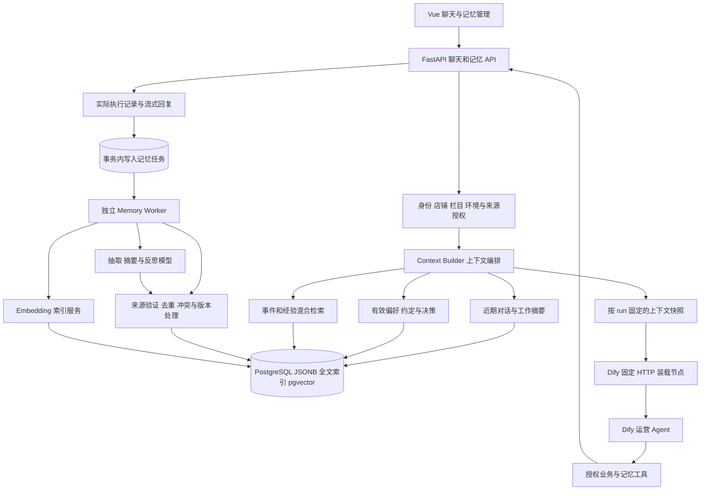
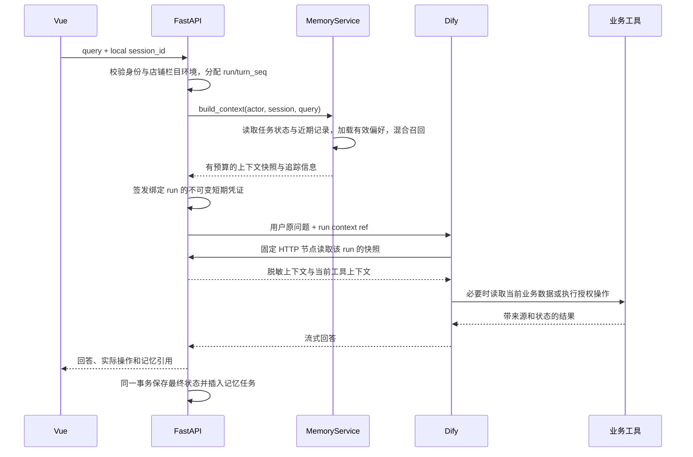
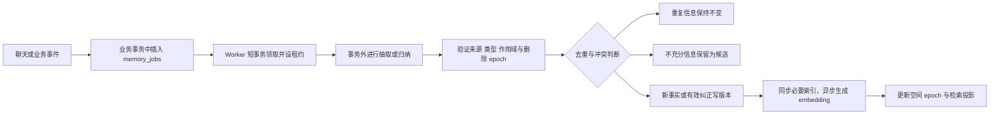

# commerce-copilot 完整记忆系统架构建议

日期：2026-10-20。状态：设计稿，尚未实现。配套资料：[前期调研](agent-memory-survey-2026-10-20.md)。

## 1. 架构决策

建议采用“后端统一管理的分层记忆系统”：保留 Vue、FastAPI、Dify 和 PostgreSQL，在后端增加 memory 模块、持久化任务队列和独立记忆 worker；PostgreSQL 增加 pgvector，提供结构化、关键词和向量联合检索。

记忆由业务系统持有。Dify 接收后端编排好的上下文，按需调用记忆工具，也可以提交候选记忆。写入资格、权限、来源、版本、冲突、删除与保留策略由后端决定。

首版完成读、写、更新、反思、检索、过期、遗忘、审计和故障恢复的闭环。基础设施先采用一个 PostgreSQL 加独立 worker，架构内部按模块划分；不要求迁移现有 Agent 编排框架。

默认使用场景：当前运营账号管理已授权店铺；记忆可能涉及真实店铺、接口演练和合成数据；用户希望跨会话保留偏好、延续工作，并从历史操作中积累经验。本文的时间、token 和性能数字是起始配置或验收目标，不是实测结果。

## 2. 当前实现决定的接入边界

| 当前事实 | 已核对位置 | 设计影响 |
| --- | --- | --- |
| ChatRun 保存问答、状态、引用和实际操作结果；Conversation 映射 Dify 会话 | backend/commerce/models.py；main.py 的 /api/chat | 可作为记忆来源，但不把模型回答直接认定为业务事实 |
| Actor、Membership、shop_id、scope_fingerprint 控制店铺与数据环境；会话另有 workspace | backend/commerce/auth.py；main.py 的会话校验 | 记忆沿用当前身份与授权；栏目原始聊天保持隔离 |
| Dify Agent 当前配置 history window size=6 | scripts/generate_dify.py；dify/chatflows/operator.yml | 正式切换时，由后端接管近期上下文，关闭该节点内置历史注入，避免两份记忆相互冲突 |
| Agent 迭代上限为 5；后端每轮最多 8 次模型触发工具调用 | scripts/generate_dify.py:162；main.py:223 | 固定上下文装载不消耗模型工具次数；可选记忆工具仍计入 8 次总上限 |
| 工具和六个可复用 Workflow 均固定绑定服务端 context_ref | scripts/generate_dify.py:146、170 | 新增每轮不可变的 run context，所有工具和子工作流绑定同一份请求上下文 |
| 工具 context_ref 当前随 Conversation 复用，request_id 在下一轮更新 | main.py:355 | 新设计拆开稳定会话身份与短期运行凭证，避免旧调用被归到下一轮 |
| 有持久化剪辑任务、SOP worker 和平台 worker | ops_worker.py；main.py 的 lifespan | 记忆模型任务独立执行，不能阻塞剪辑与平台同步 |
| Compose 当前使用普通 postgres:16；没有向量扩展配置 | compose.yaml | pgvector 部署与版本化数据库迁移是明确新增项 |
| 当前没有组织租户表和店铺记忆管理员授权 | models.py 的 User、Membership | 默认只启用个人、个人店铺和工作区记忆；共享店铺记忆需要新增明确授权 |

以上是本次源码核查，不代表运行中的已发布 Dify 配置已经同步，也不代表已具备下文的新能力。

## 3. 总体架构



MemoryService 初期是 FastAPI 代码库内的模块，不另开一套业务数据库。独立 worker 通过同一数据库领取任务；Embedding 模型可独立服务，避免把模型常驻内存开销放进每个 API 进程。

## 4. 五类记忆及业务事实的职责

| 类型 | 保存什么 | 示例 | 默认使用方式 |
| --- | --- | --- | --- |
| 工作记忆 working | 当前会话目标、已确认决定、未解决问题、近期消息 | 本次分析看哪些店、什么时间范围，还有哪份报表缺失 | 同一 session/workspace 注入；任务完成后归档，必要时生成事件 |
| 语义记忆 semantic | 稳定偏好、店铺约定、术语解释 | 报告先列异常；A 店文案偏简洁 | 精确 key 读取高优先级项，其余按需检索 |
| 情景记忆 episodic | 一次具体事件、操作、结果和证据 | 某批次字段映射导致校验失败，修正后成功入库 | 按问题、实体、时间召回 |
| 流程经验 procedural | 从事件归纳的适用条件、操作步骤、成功与失败条件 | 遇到某种报表格式，先检查日期列和金额单位 | 默认候选；验证后作为建议召回，不能改变工具权限或固定规则 |
| 决策记忆 decision | 用户已经确认的计划、约束和变更关系 | 活动预算调整；原定方案取消 | 显式状态、有效期、替代链；只表达用户决策，不证明活动已执行 |

库存、价格、订单、任务状态和剪辑结果继续由现有业务表及工具提供。记忆可以保存“当时发生了什么”的历史证据与资源引用，回答当前业务值前必须重读权威数据。

现有知识库继续保存说明资料与业务文档；记忆保存与用户、店铺、任务和历史经验有关的信息。两者通过来源引用连接，更新和权限各自管理。

## 5. 记忆作用域和授权

### 5.1 空间模型

| space_kind | 标识示例 | 所有者与默认读者 |
| --- | --- | --- |
| personal | user_id | 仅本人；适用于不含店铺私有信息的通用偏好 |
| personal_shop | user_id + shop_id + environment | 仅本人且仍拥有该店铺权限 |
| workspace | user_id + effective_shop_set + environment + workspace | 同一工作区的私有上下文与历史摘要 |
| task | user_id + business_resource_id + environment | 同时满足会话上下文和业务资源授权的本人 |
| shop_shared | shop_id + environment | 明确获准读取/发布的成员；需要新增 memory_grants |

当前默认上线前四类。共享空间由部署管理者通过受控管理接口发放 publish/manage/read 权限，不能由模型、普通 Membership 或“operator”角色自行推导。

某条记忆若来自多个店铺，required_shop_ids 保存完整集合，读取者必须拥有全部所需权限；不允许只拥有 A 店权限时读到 A/B 店综合摘要。真实、演练和旧合成数据建立明确的 environment 边界，聚合店铺场景同样检查环境，不能把 shop_id=null 解释为无范围限制。

### 5.2 来源约束

- 原始聊天属于原用户与原栏目。跨栏目可复用的是通过规则批准的偏好、店铺约定或业务事实引用；不能据此开放其他栏目聊天正文。
- 从私人聊天提取的文字不会自动成为共享店铺记忆。发布需要明确操作、发布权限和来源可共享性检查。
- 派生摘要和经验的可见范围不得宽于来源的共同可见范围。来源被撤权、删除或失效后，依赖它的派生记忆也需要失效或重建。
- 每次查询均由后端计算允许空间，并在 SQL 查询中限定；索引返回后再次核验。客户端和模型不能自行指定 user_id 或放宽 shop_id。
- scope_fingerprint 用于运行快照和授权变化检测；记忆实体用稳定空间 ID 标识，避免把一次权限集合的指纹当成永久所有权。

## 6. 核心数据模型

以下是逻辑表设计，实施时再形成完整 DDL、外键、索引和迁移。

| 表 | 核心职责和关键字段 |
| --- | --- |
| chat_sessions | 新增本地稳定会话：id、user_id、workspace、scope、environment、context_epoch、current_dify_conversation_id、next_turn_seq。现有 Conversation 作为上游会话映射并关联 session、epoch 和 retired_at |
| memory_spaces | 记忆空间：kind、owner_user_id、shop_ids、workspace/task、environment、epoch、write_policy、retention_policy |
| memory_grants | 共享空间的用户授权及 read/publish/manage 权限；默认不产生共享授权 |
| memory_items | 一个逻辑记忆的当前投影：space_id、kind、subject_type/id、predicate、value、head_revision、状态、来源等级、review_at、expires_at |
| memory_versions | 版本正文和变化记录：item_id、revision、value、valid_from/to、recorded_at、supersedes_version_id、操作理由、actor、model/prompt/schema 版本 |
| memory_evidence | 可回到源记录的证据：item_version、source_type/id/version、run/turn、引用片段位置或脱敏摘要、source_role、required ACL、内容摘要哈希 |
| memory_links | typed 关系：derived_from、supersedes、about、outcome_of；目标可以是其他记忆版本或现有商品、任务、批次和脚本 ID |
| memory_chunks | 可重建的检索投影：memory_version_id、chunk_no、检索文本、分词结果、embedding、model/revision/dimension、index_state |
| memory_jobs | 兼作事务 outbox 的持久化任务：event_type、source_id/version、dedup_key、state、lease_owner/until、attempts、next_attempt_at、expected_epoch |
| memory_run_contexts | 每轮上下文快照：run_id、session_id、scope_hash、space_epochs、context_epoch、选中的版本与证据 ID、状态、短期 payload、expires_at |
| memory_suppressions | 遗忘与删除的阻断规则：space、规范化 subject/predicate 或来源范围、epoch、reason。保留阻断所需的最少标识，不保留已删除正文 |

复用现有 Audit 记录记忆变更、发布、删除和实际工具执行；审计只记录必要的 ID、版本、原因及结果，不复制全部敏感正文。为 ChatRun 增加 session_id、turn_seq、finalized_at 和上下文追踪 ID。

### 6.1 关键一致性约束

- 空间身份使用规范化字段计算 stable key；同一空间中已定义为单值的 subject/predicate 必须拥有唯一逻辑 item。
- 多值偏好用明确集合语义；事件以事件 ID 为身份，不能把相似事件误合并为一个事实。
- 采用 optimistic revision 更新；事务内锁定逻辑 item，旧版本修改返回 409，不做最后写入者无条件覆盖。
- 版本正文不被新内容覆盖；旧版本的时效封口和当前投影更新由时间线服务执行并审计。未来生效和追溯纠正必须有确定的区间规则。
- embedding 唯一键包含 memory_version、chunk、model_revision。不同模型或维度的向量不能混查。
- 记忆正文删除是“版本保留”的明确例外，删除流程必须同时清理历史正文和投影。

## 7. 一次请求如何读取记忆



Context Builder 按以下顺序分配上下文：

1. 当前请求的已确认约束、有效权限和必要纠正。
2. 当前工作摘要与最新未归纳消息，保证对话连续性。
3. 与任务相关的有效偏好、店铺约定和决策。
4. 少量有用的历史事件与已验证经验。

起始建议：工作摘要不超过 800 token，近期消息约 1800 token，长期偏好与决策约 700 token，历史事件/经验约 700 token，总记忆上下文约 4000 token。当前问题、固定指令、工具契约、工具结果和模型输出另行预留；由实际模型上下文容量动态缩减，不能用字符数直接当 token。

重要约束不按相似度静默淘汰；如必要约束彼此冲突，返回冲突并澄清。无证据的查询允许返回空集。可选历史检索超时，只降级这一部分，并标记 memory_status；核心当前约束不可用时，不能假装完整知道用户的约定。

### 7.1 摘要的连续性

工作摘要保存 through_turn_seq 和来源范围。每轮加载摘要覆盖点之后的最新消息；不能简单拼“旧摘要 + 最后 6 轮”而遗漏中间对话。

当未归纳区间过大时：优先读取结构化决策和未完成项，补做受限摘要；仍超预算则明确缺失范围并提供定向读取，不声称完整恢复。后台摘要不能覆盖更晚版本；候选写回时检查 turn watermark、revision 与删除 epoch。

## 8. 一次交互如何形成记忆



### 8.1 写入入口

| 入口 | 行为 |
| --- | --- |
| 用户明确说“记住/改成/忘记” | 通过记忆控制工具或 UI 立即处理；工具只有校验通过并提交事务后才能返回“已保存/已忘记” |
| 正常聊天 | 完成或中断后异步分析用户输入；一般性推断成为候选，不直接当作长期事实 |
| 业务操作成功 | 在实际业务提交点形成带资源版本的事件，不依赖模型事后复述 |
| 操作失败或重试 | 保存失败条件、尝试和最终结果；失败原因未证实则标为未知或假设 |
| 周期性整理 | 归并重复证据，整理已完成任务，产生待验证经验和复查任务 |

明确记忆操作提交后，不再要求用户逐条确认。间接推断不必反复打断聊天，可以显示为候选或在管理页集中处理。

### 8.2 来源与晋升规则

- 用户明确陈述可以形成个人偏好或用户决策；不能据此证明平台操作已完成。
- 业务完成事实必须有数据库状态、工具执行回执或可验证资源版本。
- 模型生成的计划与文案以 draft/proposed 保存；“建议执行”不等于“已经执行”。
- 一轮聊天失败，之前实际成功的工具操作仍可形成事件；失败回答中的猜测不能变成已证实经验。
- 流程经验初始为 candidate，经过可复现回放或用户明确认可后成为 validated；保留适用条件和失败反例。样本数、观察到的成功率只描述记录，不直接推断业务因果或商业效果。
- 重复表达只能追加证据，不应靠重复次数无限提高可信度。模型的 confidence 是参考，晋升仍依赖来源规则。

当前 Audit/effects 只提供部分操作元信息。实施时需要在选定业务提交点增加脱敏事件字段，例如资源 ID、前后版本、输入类型和结果；不能把现有审计记录假定为完整工具轨迹。

## 9. 去重、纠正和时间线

处理顺序：先依据空间、实体和规范化 predicate 定位逻辑项，再比较值、来源与有效时间。语义相似只用于找候选，不能直接决定两条记忆相同。

| 情况 | 决策 |
| --- | --- |
| 同一偏好被重复表达 | 保持值，追加不同来源的证据 |
| 用户明确纠正同一个偏好 | 新版本替代旧版本，保留变更原因 |
| 更具体的场景偏好 | 保存到更具体的作用域，不误覆盖通用偏好 |
| 证据同级且互相矛盾 | 状态 conflict；避免同时当作确定事实注入，按需要澄清 |
| 历史事件与当前值不同 | 保留历史事件；当前视图按有效时间选择 |
| 未来生效的约定 | valid_from 设为未来日期，当前时间不提前应用 |
| 已取消的决策 | 原决策状态 cancelled，建立替代/撤回关系；保留事件历史 |

例如：“A 店报告先列成交额”后来改为“先列退款异常”，应更新 A 店对应用户的报告排序偏好；B 店偏好和历史报告不会被顺带改写。查询历史时可以回答某日有效版本，普通请求使用当前有效版本。

同时记录 occurred_at/valid_from 与 recorded_at，内部使用 UTC，面向用户的业务日期按 Asia/Shanghai 解释。补录历史资料时，不能把上传时间误当事件发生时间。

## 10. 检索与模型选择

### 10.1 检索流程

允许空间和当前有效状态过滤 → 精确实体/逻辑 key → 中文关键词召回与向量召回 → RRF 合并 → 版本和来源核验 → 可选 reranker → 类型去重与 token 预算裁剪。

建议首版每路最多 20 个候选、合并后最多 40 个，可选重排前 15 个，最终约 3～8 条，均为可调默认值。当前明确规则按 key 获取，不依赖向量相似度。SKU、订单、任务和批次编号优先做规范化精确匹配。

关键词层使用应用层版本化中文分词，将分词结果送 PostgreSQL 的 simple 全文检索配置；中文别名、行业词和实体词典进入分词版本。不能把 PostgreSQL 默认英文分词配置称为中文 BM25。首版全文排序与向量 RRF 即可；以后引入真正 BM25 实现需要独立验证收益。

首版在授权后的较小候选集合上使用精确向量检索，规模扩大再评估 HNSW。pgvector 的 ANN 扫描与 SQL 过滤存在召回不足的取舍，必须检查执行计划与 Recall；启用 HNSW 时评估 iterative scan、分区或部分索引，不能把 WHERE 条件误认为 ANN 已经物理预过滤。[pgvector 官方说明](https://github.com/pgvector/pgvector)

### 10.2 模型选择

- 抽取、摘要、反思：新增无业务写工具的 Dify Memory Maintenance Workflow，输出严格 JSON。沿用当前模型接入方式，固定 workflow/model/prompt/schema 版本；后端用 Pydantic 验证。抽取结果只可引用传入的 source allowlist。LLM 不直接提交数据库事务。
- Embedding（2026-10-21 按用户要求更新）：由用户后续提供 API；首版提供 OpenAI 兼容请求适配器，地址、密钥、模型、维度和版本均通过私有配置注入。不下载权重、不启动本地模型。未配置时使用结构化和关键词检索，记忆正文正常保存；配置后后台补建索引。具体配置见[实施与验收](../acceptance/记忆系统实施与验收.md)。
- Reranker：首版未启用；在有实际检索评测和额外延迟数据后再决定。任何模型、依赖、镜像或文件下载都须先得到用户明确允许。

查询链路默认不增加串行 LLM 改写、HyDE 或逐条 LLM 判定；抽取和反思主要放后台。更换 embedding 时建立新索引版本、后台重建并切换，不能混用旧向量。依赖不可用时明确标记语义检索降级，精确 key 和关键词检索继续按授权工作。

## 11. Dify 与当前聊天协议的具体改造

### 11.1 本地会话与运行身份

前端使用稳定 local session_id；Conversation 保留上游 Dify 会话映射。轮次使用 run_id 和 turn_seq。每轮签发新工具凭证，固定 user/scope/workspace/environment/run，不修改旧凭证的 request_id。

现有 conversation_id 在迁移期映射到 local session；新前端改发 session_id。API 明确返回 session_id 与 transport conversation 标识，不能把两种 ID 在同一字段中无说明替换。权限变化或上游上下文重建时，保留本地会话展示历史，生成新的上游映射。

### 11.2 Chatflow

建议链路改为：Start → 固定 HTTP bootstrap → JSON 解析 → Agent → Answer。

- Start 每轮接收 run_context_ref；bootstrap 使用服务凭证加该 ref 获取已经组装好的快照，不在 HTTP 节点再次抽取或执行业务操作。
- bootstrap 返回 rendered_context、context_epoch、snapshot_id 和固定的 run 工具上下文。快照只能由对应运行读取，有短期有效期。
- Agent 的用户 query 保留用户原话；独立上下文段带入工作摘要、近期消息和长期记忆，不能把这些内容伪装成用户本轮输入。
- 关闭当前 Agent 节点内置 memory，由后端统一选择近期记录，避免删除后旧消息通过 Dify 自动历史再次注入。上游保存的历史数据仍需按删除策略单独治理。
- Commerce Read、Commerce Action 和六个 Workflow 的 context_ref 一并改绑本轮 ref；不能只改直接 API 工具而遗留子工作流。
- memory_context、近期消息和候选经验是带来源的数据。固定业务限制、工具契约和后端权限保持更高优先级，内容中的指令不能改写它们。

本地 vendor 中 AdvancedChatAppGenerator 按本次请求准备 inputs，Agent runtime 依据 node_data.memory 注入历史。正式接入仍需针对锁定的发布版本验证：连续两轮 ref 与快照更新、缺失 bootstrap 时拒绝执行、节点 memory 关闭后没有额外历史注入。

### 11.3 可选记忆工具

| operation | 行为 |
| --- | --- |
| memory_search | 当前授权空间内按 query/entity/time 查记忆；返回 ID、版本、时间、证据和状态 |
| memory_get | 按 ID 读取获准记忆与必要证据，仍检查原始来源可见性 |
| memory_propose | 提交候选记忆，或由用户明确记住请求触发受限持久化；模型不能自行发布到共享空间 |
| memory_forget | 处理有明确用户意图的遗忘；后端解析确定范围后应用阻断并失效上下文 |

精确纠正和共享发布优先用记忆管理 API。记忆工具建立独立的类型和授权判断，不混入“该栏目能否修改脚本”规则，也不获得业务写权限。可选工具仍在现有每轮总调用上限中；bootstrap 是固定步骤，有单独的一次装载限制。

## 12. 过期、遗忘与删除

### 12.1 过期与复查

工作摘要在结束后归档；决策按业务有效期或任务状态结束；偏好设置复查时间，不能仅因很久没用就反转；经验随相关业务版本变化进入 needs_review。具体保留天数配置到 space policy，正式部署前与业务要求确认。

衰减主要影响历史经验的检索排序，不能取消仍有效的明确规则。TTL 也不能代替用户删除。

### 12.2 两种用户操作

- “不再用这条记忆”：立即从后续上下文、召回和派生记忆中排除，并阻止原来源自动重新抽取；原始聊天保留可单独配置。
- “连相关历史一起删除”：另行删除选定原始聊天、记忆正文和派生内容，并对 Dify、日志与备份执行可追踪的删除/保留策略。界面明确显示各存储的处理状态；不能把本地删除等同于上游及备份已经物理擦除。

### 12.3 防止重新出现

1. 事务内登记 suppression，增加对应 space epoch；旧记忆立即不可读。
2. 标记目标版本及 derived_from 依赖失效；删除 chunks、embedding、摘要和可访问快照正文，重建不含该内容的工作摘要。
3. 处理近期原始消息：屏蔽相关来源或排除整条消息，不能仅删向量；来源保留但不再自动用于记忆。
4. 增加 session.context_epoch、退役相关上游 Conversation。关闭 Dify 内置历史是前提；新请求从经过筛选的本地上下文重新构建。
5. 对正在生成且使用了目标记忆的运行中止后续输出和工具调用；已实际发生的业务操作如实保留，不自动重放写操作。下一次请求使用新快照。
6. worker 写回检查 expected_epoch 与 suppression；删除前已经开始的抽取、重建和缓存任务不得让旧内容复活。
7. 恢复备份后先重放删除/阻断记录，再允许检索和派生任务运行。完整物理清理完成前保持可见性阻断。

“忘记某个主题”需要解析到可展示的主题和来源集合；范围有歧义时才澄清，不能默默扩大为删除全店历史。

## 13. 后台任务、事务与失败恢复

- 业务提交、ChatRun 最终状态与相应 memory_jobs 插入同一数据库事务。已有业务函数内部提交的路径必须在实际提交点接入，外围补一条审计不能提供事务原子性。
- 领取任务用短事务与 SKIP LOCKED，设置租约后提交；HTTP/模型调用在事务外执行，避免持有数据库行锁等待模型。
- 至少一次执行加幂等写入：dedup_key 包括 source/version、job_type、模型/提示词/schema 版本。索引重试不能重复添加逻辑记忆。
- 写回前重新校验来源版本、授权、revision 和删除 epoch；过期租约可由其他 worker 领取。采用递增退避、有上限重试和 dead-letter 状态。
- 进程启动不批量把所有 running 任务改回 queued；根据租约和心跳恢复，支持后续多 worker。
- 被中断的聊天仍落库；最终状态未写入的运行由 watchdog 标记 interrupted，已有业务回执独立保留。
- 抽取模型返回坏 JSON、引用不存在的证据或试图扩大作用域时，任务失败或候选隔离，不伪造“已保存”。
- 结构化显式记忆提交可以先于 embedding 就绪，立即通过 key/关键词可读；语义索引标记 pending，失败不会丢失事实。

当前部署可以将 memory worker 作为单独进程启动；未来独立部署时共用同一任务协议。初期无需增加 Redis 或 Celery，只有吞吐、调度或运维数据证明有需要时再替换队列实现。

## 14. 管理 API、界面和可观测性

### 14.1 建议接口

| 接口 | 用途 |
| --- | --- |
| GET /api/memory/items | 查看当前用户可管理记忆，按作用域、类型和状态过滤 |
| GET /api/memory/items/{id} | 查看正文、版本、来源和派生关系；逐层检查授权 |
| POST /api/memory/items | 显式新增，服务端决定允许空间；返回已提交版本 |
| PATCH /api/memory/items/{id} | 携带 expected_revision 纠正内容或有效期 |
| POST /api/memory/forget | 受控范围遗忘，返回 suppression 与清理任务状态 |
| POST /api/memory/items/{id}/publish | 有授权时发布到共享空间，并重新检查可共享来源 |
| GET /api/chat/runs/{run_id}/memory | 该次回复使用的记忆 ID/版本、状态和可访问证据 |
| POST /internal/agent-context/bootstrap | Dify 固定读取本轮快照；服务认证加短期 run ref |

列表与写入区分“我的偏好”“店铺约定”“工作摘要”“历史事件”“经验候选”。用户可纠正、停用、遗忘、查看来源和版本；共享发布单独显示。设置区区分“读取历史记忆”“自动形成记忆”“临时对话”，关闭开关本身不删除历史。

聊天中“已使用记忆”只展示少量相关依据。记忆保存通知以后台实际提交结果为准；failed/interrupted/queued 都不能显示为成功。UI 不向普通用户展示 embedding、队列或数据库实现细节。

记录：scope_check_ms、working_context_ms、query_embedding_ms、lexical_ms、vector_ms、rerank_ms、assemble_ms、bootstrap_ms、首 token 和总时间；还要记录抽取延迟、队列积压、索引 pending、冲突率、删除阻断与清理状态。检索追踪保存 ID/版本与排序理由，避免把完整正文无限复制进日志。

## 15. 起始运行预算和降级

| 项目 | 起始策略或目标 |
| --- | --- |
| 必要偏好与当前状态读取 | 走结构化 key 查询；失败需要明确状态，必要约束不明时请求澄清 |
| 可选历史检索 | 起始预算 800ms，超时取消或截断该分支；目标 p95 新增首 token 延迟不超过 1 秒，待硬件与真实联调验证 |
| Query embedding 与 reranker | 起始分别约 350ms、250ms 子预算；达不到则关闭重排或显式降级，不将慢任务拖入主链路 |
| 显式记忆写入 | 数据库提交后立即通过结构化路径可读；向量后台补齐 |
| 自动记忆可见性 | 目标 p95 在有效来源完成后 30 秒内；队列和模型慢时显示 pending，不承诺下一秒就能召回 |
| 模型调用预算 | 普通一轮最多一项批量抽取任务；摘要按未归纳区间和预算触发；反思按任务结束或周期批量执行 |

这些数字是用于验收的起点。Embedding 服务未预热、CPU 部署或上游模型拥塞都可能导致目标失败，必须记录失败率与降级路径再调整。

缓存初期只缓存 query embedding 和非敏感词典；记忆内容缓存晚于正确性验收。若启用内容缓存，key 必须包括有效授权、环境、space epochs、context_epoch、模型与查询版本；删除和撤权同时使快照失效。

## 16. 与现有项目对应的文件规划

```text
backend/commerce/memory/
  api.py                 用户管理接口
  schemas.py             类型与候选 JSON 契约
  policy.py              空间 权限 来源与晋升规则
  service.py             显式记忆命令和事务边界
  context.py             近期上下文 摘要与 token 预算
  retrieval.py           key 全文 向量和排序
  extraction.py          结构化抽取与来源验证
  consolidation.py       去重 冲突和时间线
  reflection.py          经验候选与验证结果
  forgetting.py          suppression 派生失效和清理
  jobs.py                持久化事件 租约和重试
  worker.py              独立执行入口
  providers.py           Dify 模型和 Embedding/Reranker 接口
  repository.py          授权后的查询与版本写入
backend/migrations/      版本化记忆迁移及升级回退说明
backend/tests/           记忆生命周期 授权 并发与故障测试
contracts/               记忆工具及 bootstrap 契约
dify/workflows/          Memory Maintenance Workflow
frontend/src/            记忆管理和聊天引用展示
```

当前 main.py 接入会话身份、上下文、bootstrap、最终任务事件；auth.py 复用 Actor 和 scope 检查；业务提交点产出选定事件；scripts/generate_dify.py 是 DSL 修改来源，生成后更新契约与发布锁定记录。schema 以版本化迁移管理，不在每次启动任意重算历史或覆盖记忆。

## 17. 实施顺序与完整首版定义

| 阶段 | 产出 | 退出条件 |
| --- | --- | --- |
| 1 数据与正确性基础 | 空间、版本、来源、任务、suppression；local session；显式增改查忘；管理页 | 能纠正和遗忘，跨账号/店铺/环境/栏目不泄露，并发不覆盖 |
| 2 上下文与自动形成 | Context Builder、工作摘要、固定 bootstrap、不可变 run ref、关闭 Dify 自动历史、异步抽取 | 跨会话偏好生效，连续对话无遗漏，失败回复不制造完成事实 |
| 3 混合召回与经验 | 分词、pgvector、索引版本、事件记忆、反思候选及验证 | 长历史、中文、SKU 和时间查询达标；有证据的经验可复用 |
| 4 完整运行验收 | 删除级联、进行中运行失效、重启恢复、上游清理状态、可观测性、灰度开关和回退 | 完整生命周期及现有业务回归通过，交付运行报告 |

四阶段完成才称完整首版；第一阶段只称记忆基础能力。共享空间可以在明确发放授权后启用，数据和 API 从一开始预留其边界。复杂图数据库、端到端 RL 和多 Agent 记忆协作是后续扩展，不是首版闭环的前置依赖。

## 18. 验收方案

### 18.1 核心场景

1. 明确保存“报告先列异常”，切换会话或刷新后生效；未开启自动记忆时不自行抽取。
2. 改成另一种报告顺序，当前请求使用新版本，历史查询保留时间语义；未来生效的设置不提前应用。
3. A 店约定不影响 B 店；全部店铺视图不把不同店铺约定合为一个值。
4. 账号间隔离；撤销一个来源店铺权限后，综合摘要与派生经验也不可见。
5. 普通栏目无法通过记忆 evidence 接口打开其他栏目原始聊天；共享发布不能扩大私人来源权限。
6. 演练与正式记忆隔离；旧版 general 聊天默认不批量灌入当前栏目。
7. 删除后，近期消息、摘要、旧快照、向量和旧 worker 任务都不能重新注入该内容；中断恢复与备份恢复同样验证。
8. 工具实际失败、模型却说成功时，记忆记录失败；整轮失败但已保存草稿时，实际草稿事件仍被保留。
9. 重复投递事件、并发修改、worker 中断、索引失败都不产生重复事实或丢失显式偏好。
10. 摘要落后超过近期窗口、长消息、取消任务后继续问，都不恢复已经失效的决定。
11. Embedding/模型超时和无检索结果都有明确降级；权限判断失败时不开放记忆。
12. 注入式网页或工具文字不能把自身内容晋升为系统规则、共享政策或已执行事实。

### 18.2 对照和指标

使用固定生成模型、固定问题与时间线，比较：现有 6 轮窗口；工作摘要加近期消息；再加结构化长期记忆；再加历史事件/经验检索。对照组保持相同总上下文预算，另记录实际 token、模型调用和缓存状态。

指标至少包含：偏好遵循率、当前状态正确率、证据可回溯率、错误写入率、未知信息拒答、经验复用效果、检索证据命中、权限泄露和遗忘复现；同时报告首 token、总时延、各阶段耗时、写入可见性、失败/降级与成本。

授权隔离、遗忘阻断、显式纠正、幂等写入和关键业务事实判定在确定性验收用例中要求全部通过；开放问答质量使用人工复核加固定裁判，不以一次模型打分代替判断。

后端测试之外，需要 PostgreSQL/pgvector 集成测试、锁定 Dify 版本联调、前端管理与聊天浏览器验收，以及 1440/1024/390 宽度的可见结果检查。合成或脱敏材料单独标记；真实模型联调与真实抖店平台验证分别报告，不能混称。

### 18.3 上线和回退

先 shadow 模式只形成候选并记录召回，不影响回答；再按测试账号开启读取；通过对照后灰度扩展。配置开关分别控制 read、auto-write、reflection、semantic-search、shared-memory。

回退时停用新自动读写并保留数据；不能在存在遗忘阻断后直接开启旧 Dify 历史窗口。应继续使用经过 suppression 过滤的后端近期上下文，或创建干净会话。历史导入采用按范围、可重入、可审查任务，默认不把全部历史无差别重算。

## 19. 选型结论

推荐实现后端自有的记忆控制层，使用 PostgreSQL JSONB、全文检索和 pgvector 完成首版闭环，复用当前 Dify 模型接入。理由是本项目最需要控制跨店铺/栏目来源、已执行事实、当前有效状态以及遗忘后的上下文，控制权应与现有业务授权和事务放在同一侧。

Mem0、Hindsight 或 Graphiti 可以作为后续 MemoryIndex/Extractor 适配器候选；它们需要遵守同一空间、来源、版本和删除契约，并接受同场评测。接入后仍不能绕过后端真值校验和共享规则。当前没有证据证明自建或任一框架在本项目的质量/成本上已经胜出。

该方案借鉴了分层检索、后台整理和时序记忆思想，但具体职责、数据模型与参数是面向本项目提出的设计，不是厂商架构的复制或性能承诺。
