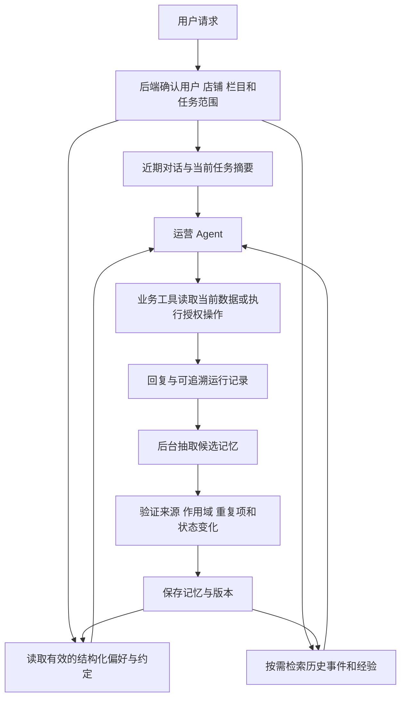

# Agent 记忆管理调研

调研日期：2026-10-20。目标：了解领先 Agent 公开采用的记忆机制，为 commerce-copilot 后续选型提供依据。

本次是官方文档、公开代码和原始论文调研，没有安装记忆框架、运行外部服务、复现论文分数或修改业务代码。产品内部未公开的存储和排序实现不作推断；官方示例也不等同于该厂商所有产品的内部架构。以下选型判断均为建议。

## 1. 核心发现

公开方案已经覆盖一套完整的生命周期：选择值得保存的信息，形成可追溯记录，组织和整理记忆，在权限和上下文预算内召回，并处理纠正、过期和删除。

值得借鉴的组合是：

- 工作上下文：近期消息、当前任务状态，以及上下文压缩。
- 长期事实与偏好：结构化记录或短笔记，跨会话复用。
- 事件与经验：发生了什么、采用了什么操作、结果如何、有什么可复用经验。
- 按需读取：少量摘要或目录常驻上下文，具体记录在需要时读取。
- 后台整理：合并重复记录、处理变化、形成更高层的摘要或经验。

这些是对下文公开方案的归纳，不表示所有产品都采用相同分层。LangChain 官方将记忆内容区分为语义、情景和程序性记忆，并明确区分请求链路内写入与后台写入。[Memory overview](https://docs.langchain.com/oss/python/concepts/memory)

## 2. 实际 Agent 与厂商公开方案

| 对象 | 已公开的机制 | 可借鉴之处与边界 |
| --- | --- | --- |
| Claude Code | 人工维护的 CLAUDE.md 与自动记忆并存；MEMORY.md 作为索引，主题文件按需读取。当前文档规定启动时读取索引的前 200 行或 25KB，以先到者为准。 | 短索引与详细笔记分离；可查看和编辑。人工指令与自动学习内容要区分。[官方文档](https://code.claude.com/docs/en/memory) |
| OpenAI Agents SDK / Sandbox Agents | Session 保存会话历史；Compaction 管理长任务上下文；Sandbox Memory 从历史运行提炼可复用信息到文件。运行开始注入 memory_summary.md，需要时搜索 MEMORY.md，再打开详细运行摘要；会话关闭时先提取，再整合记忆。 | 体现摘要、索引、详细来源的渐进读取。跨运行复用仍需要保存记忆目录。这是公开 SDK 能力，不据此推断 ChatGPT 或所有 Codex 部署的内部架构。[官方指南](https://developers.openai.com/api/docs/guides/agents/sandboxes) |
| Anthropic Managed Agents | Memory store 是可挂载到沙箱的文本文档集合，Agent 用文件工具读写；每次改动产生不可变版本。Dreams 异步读取已有记忆与过去会话，输出新的整理后记忆库，保留输入库。 | 文档式持久化、版本审计与后台整理可以组合。Memory store 页面标为 Beta，Dreaming 仍有 research preview 范围限制。[Memory stores](https://platform.claude.com/docs/en/managed-agents/memory)、[Dreams](https://platform.claude.com/docs/en/managed-agents/dreams) |
| Letta Code / 当前 Letta 文档 | MemFS 使用 Git 管理的记忆文件系统，支持跨会话记忆；dreaming 在后台整理经验。2026-02 的 Context Repositories 说明文件层级、描述和固定加载区如何控制读取。 | 版本管理、分层读取、后台整理。介绍 Letta 时，应区分较早的 MemGPT/memory blocks 设计与当前文件式方案。[当前文档](https://docs.letta.com/configuration/memory)、[Context Repositories](https://www.letta.com/blog/context-repositories/) |
| Manus 的公开工程方案 | 将文件系统作为外部上下文；被移出上下文的网页和文档保留 URL 或文件路径以便恢复；用 todo.md 持续记录任务进展。 | 强调任务状态外置和可恢复压缩。来源是其 2025 年公开工程文章，不能用它证明 2026 年全部内部实现，也不能将任务内文件直接等同于用户跨任务长期记忆。[工程文章](https://manus.im/blog/Context-Engineering-for-AI-Agents-Lessons-from-Building-Manus) |

OpenAI 的官方示例还明确区分：Compaction 帮助继续当前长任务，Memory 帮助未来运行复用偏好和流程经验；案例结论留在有引用、可审阅的产物中。[Memory and Compaction 示例](https://developers.openai.com/cookbook/examples/agents_sdk/building_reliable_agents_memory_compaction)

## 3. 可以集成的记忆框架与服务

下表比较定位与机制，不作跨框架性能排名。

| 方案 | 主要机制 | 适合重点考察的需求 |
| --- | --- | --- |
| Mem0 新算法 / V3 | 单次抽取并追加新记忆，结合多种检索信号；新旧事实保留，依赖检索和时间上下文选择。 | 给既有应用补充偏好、事实记忆；重点验证纠正后的当前状态、记忆增长与清理。[平台迁移说明](https://docs.mem0.ai/migration/platform-v2-to-v3) |
| Zep / Graphiti | Graphiti 增量处理事件，构建实体、关系与事实的时序图；有双时间模型、事实失效处理与混合检索。Zep 提供基于 Graphiti 的托管上下文服务。 | 多实体关系及其变化，例如活动、负责人、商品之间的关系。需要评估抽取质量和额外基础设施。[官方概览](https://help.getzep.com/graphiti/getting-started/overview) |
| LangGraph + LangMem | Checkpointer 负责同一 thread 的状态；Store 负责跨 thread 长期记忆，以 namespace/key 组织 JSON。LangMem 提供记忆抽取、整理，以及后台处理等构件。 | 需要自主控制 schema、作用域和写入策略的开发团队。它们提供构件，业务规则仍需设计。[LangGraph 概念](https://docs.langchain.com/oss/python/concepts/memory)、[LangMem 后台处理](https://langchain-ai.github.io/langmem/reference/memory/) |
| Hindsight | Retain 保存事实和经验；Recall 融合语义、关键词、图和时间检索；Reflect 在记忆之上综合推理。Mental Models 可预先形成并刷新常用综合视图。 | 事件、经验和反思型记忆；重点区分原始事实、归纳结果与推断。[Recall](https://hindsight.vectorize.io/developer/retrieval)、[Mental Models](https://hindsight.vectorize.io/developer/mental-models)、[论文](https://arxiv.org/abs/2512.12818) |
| AWS Bedrock AgentCore Memory | 内置语义、偏好、摘要和情景等策略；情景策略包含抽取、整合、反思。 | 已采用 AWS、希望将抽取和整理托管的应用。[内置策略](https://docs.aws.amazon.com/bedrock-agentcore/latest/devguide/long-term-configuring-built-in-strategies.html)、[情景策略](https://docs.aws.amazon.com/bedrock-agentcore/latest/devguide/episodic-memory-strategy.html) |

### Mem0 的版本差异会直接影响选型

旧算法的典型介绍是先抽取事实，再决定 ADD / UPDATE / DELETE / NONE。当前新算法改为 ADD-only：自动抽取时追加记忆，保留新旧事实，检索时选择相关的当前信息。因此，不能直接将旧论文或旧教程里的“自动覆盖冲突事实”作为当前版本保证。

还要区分 OSS 与 Platform。当前 OSS 迁移文档写明内置 graph memory 已移除，Platform 提供对应能力；OSS 的实体匹配集合也不等同于 graph memory。[OSS 迁移说明](https://docs.mem0.ai/migration/oss-v2-to-v3)

这体现两种不同设计：一种维护可更新的当前摘要，另一种保留追加式历史、在读取时解析变化。具体应用可以同时保留事件历史和一个由应用明确维护的当前有效状态。

## 4. 研究前沿在解决什么问题

以下是研究方向，不能直接理解成已经在所有生产 Agent 中使用。

| 研究 | 关键思想 | 对运营 Agent 的启发 |
| --- | --- | --- |
| A-MEM，2025 | 为记忆生成带关键词、标签和上下文的笔记，动态建立链接，并随新信息调整历史记忆表示。 | 经验之间可以建立可追溯关联。[论文](https://arxiv.org/abs/2502.12110) |
| AgeMem，2026；本次查看版本为 2026-07 修订版 | 将保存、读取、更新、总结、丢弃暴露为 Agent 的工具动作，用强化学习训练统一管理长短期记忆的策略。 | “何时记、记什么、何时读”也可以学习。复用设计思想与复现训练方案是不同工作量。[论文](https://arxiv.org/abs/2601.01885) |
| MemRL，2026 | 冻结语言模型，在情景记忆上根据环境反馈更新效用值；先看语义相关，再考虑经验是否有效。 | 召回“过去成功解决过的问题”，而不只召回文字相似的记录。实际运营需要可靠结果信号。[论文](https://arxiv.org/abs/2601.03192) |
| StateMem / StateMemBench，2026-08 | 显式跟踪事实替代关系及依赖；评测答案使用当前状态、旧状态还是其他错误。 | 活动取消、预算调整、负责人变更等情形，应保留变化链并正确回答当前状态。[论文](https://arxiv.org/abs/2608.19652) |

上述能力多数可通过外部记忆与工具实现，不要求为每次新增信息更新模型权重；AgeMem 的策略训练则是另一层工作。记忆带来的行为改进与模型参数更新应分别说明。

## 5. 怎样理解 SOTA 分数

本次调研没有找到能够据此认定“所有场景统一最优”的公开证据。比较时至少要固定数据版本、生成模型、裁判模型、提示词、读取 token 预算和是否使用多次检索；同时报告写入成本、查询延迟与最终任务效果。

- LongMemEval 主要考察信息抽取、跨会话推理、时间推理、知识更新及未知信息拒答。[原始论文](https://arxiv.org/abs/2410.10813)
- LongMemEval-V2 转向环境经验，考察静态状态、动态状态、流程知识、环境陷阱和问题前提。它明确同时评估准确率与查询延迟。[项目页](https://xiaowu0162.github.io/longmemeval-v2/)
- StateMemBench 进一步区分系统是否仍在使用已经被推翻的旧状态。[论文](https://arxiv.org/abs/2608.19652)

一个说明取舍的例子：LongMemEval-V2 项目页的 Small 结果中，RAG slice+notes 为 51.0% / 0.2 秒，文件式 AgentRunbook-C 为 74.9% / 108.3 秒。这些是作者在其特定设置下报告的准确率与查询延迟，本次未复现；不能直接映射为本项目效果。它说明复杂检索可能提高质量，也可能显著增加等待时间。[结果表](https://xiaowu0162.github.io/longmemeval-v2/)

## 6. 对 commerce-copilot 的初步建议

基于本次对话上一轮核对的仓库实现，现有系统具备 Dify 会话历史窗口、本地聊天持久化，以及用户、店铺范围和栏目的会话校验。本节是后续设计建议，没有新增任何记忆能力，也没有核对运行中的已发布 Dify 应用。

### 先确定需要记住的内容

| 内容 | 示例 | 建议的保存与读取方式 |
| --- | --- | --- |
| 用户偏好 | “报告先列异常，再列建议” | 结构化偏好；按用户授权范围复用，保留明确纠正记录 |
| 店铺约定 | 特定店铺文案语气、报告口径 | 店铺级、带来源和版本的规则；与应用强制规则分开 |
| 当前任务 | 活动目标、当前方案、阻塞项、已取消决定 | 任务状态和简短工作摘要；变更应明确替代旧状态 |
| 历史经验 | 某次导入失败的原因、修复方法和实际结果 | 带来源、适用条件、操作与结果的事件记录，按需召回 |
| 实时业务数据 | 库存、价格、订单状态、任务完成状态 | 继续通过业务 API 或数据库读取；历史值可以带时间作为事件保存，当前值仍以业务系统为准 |

记忆记录建议至少包含：类型、所有者及作用域、内容、来源消息或业务记录、发生时间、记录时间、状态、替代关系；有时效性的内容增加有效期。机器归纳的经验要与用户明确陈述、工具证实的事实区分。

读取时由后端确定用户和店铺权限，先限制候选作用域，再检索。用户偏好可以按明确规则跨栏目复用；特定任务的工作摘要仍应限定在相关任务或栏目。namespace 或 metadata 是组织与过滤手段，不能替代后端授权。

### 建议的组合与考察顺序

这个建议综合了官方方案里的分层读取和后台整理思想，不绑定某个 Agent 框架。后续方案可以保留现有 Dify/FastAPI 分工，另行评估记忆如何在请求前注入、通过工具按需读取，以及回复后异步整理；本次未验证这些接入路径。

初步考察顺序：

1. 以现有数据库加结构化偏好、任务摘要作为可控基线。
2. 选 Mem0 与 Hindsight 的一个明确版本分别验证轻量记忆抽取与事件/经验记忆；比较它们对中文、商品编号、时间表达和纠正语句的表现。
3. 当实际问题证明需要复杂实体关系和历史关系查询时，再将 Graphiti 加入同场比较。
4. 借鉴 LangGraph 的 namespace/state/store 分工与 LangMem 的后台整理机制；是否迁移 Agent 编排框架是独立决策。

这是基于项目需求的判断，不是这些框架的性能排名。

## 7. 后续验证应怎样设计

先准备明确标注为合成或脱敏的多会话材料，覆盖：偏好跨会话复用、用户纠正、事实替代、活动取消、显式遗忘、店铺切换、授权变化、任务中断恢复、工具失败，以及未知信息。离线结果不能称为真实店铺验证。

对照组建议：

- A：现有近期会话窗口。
- B：A 加任务摘要。
- C：B 加结构化偏好与当前有效状态。
- D：C 加历史事件和经验检索。

固定同一生成模型、输入材料、提示词和上下文预算，记录最终回答正确率、当前状态正确率、错误记忆写入率、有效记忆覆盖率、检索证据命中、越权召回、删除后复现情况、写入可见延迟、首 token 时间、总响应时间、token 与模型调用成本。异步写入是否完成、缓存是否开启、失败与重试次数要单独记录。

具体版本、后端存储和接入方案应在这组对照结果出现后再确定。
